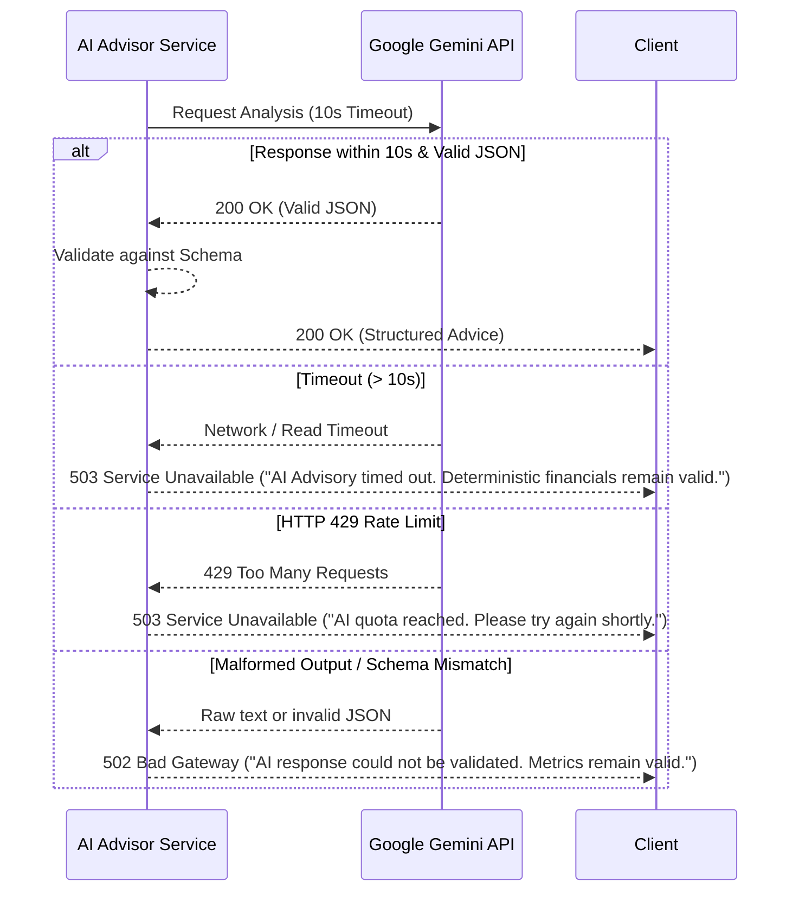

# MarginWatch — AI Risk Advisor Specification & Evaluation Plan

**Document Status:** Feature Specification (Phase 0)  
**Last Updated:** October 2026  
**Audience:** AI Engineers, Backend Architects, Product Evaluators  

---

## 1. Feature Role & Conceptual Boundaries

The **AI Risk Advisor** is an intelligent analytical layer integrated into MarginWatch to assist agency leadership in interpreting financial trajectories and taking proactive corrective measures.

### 1.1 Fundamental Guardrails & Principles
1. **Advisory Only, Never Authoritative:** The AI never calculates financial metrics (revenue, budget burn, projected overrun) and never determines the project's risk status. All numbers and risk badges are computed by the deterministic backend engine prior to invoking the AI.
2. **Zero Autonomous Mutation:** The AI is strictly read-only. It has no tools, functions, or write permissions to alter budgets, change employee cost rates, approve expenses, or modify records.
3. **Strict Grounding:** The AI is instructed and constrained to reason solely upon the metrics, estimates, and project context supplied in the backend payload. It must never invent figures or assume financial data that was not provided.
4. **Decoupled Failure:** If the AI provider (Google Gemini) is unavailable, rate-limited, or returns malformed text, the deterministic financial dashboard remains completely functional and visible.

---

## 2. Input Payload & Context Sanitization

When a Manager (`MANAGER` role) requests an AI risk analysis (`POST /api/v1/projects/{id}/ai-risk-analysis/`), the backend compiles an anonymized, structured context payload.

### Context Sanitization Protocol (Privacy & Data Minimization)
- **Included:** Project code, project status, contract revenue, planned cost budget, currency, total hours logged, actual labor cost, approved expenses total, pending expenses count and sum, estimated remaining hours, projected final cost, projected profit, budget consumption %, deterministic risk status, and deterministic status rationale.
- **Excluded:** Employee real names, personal identification numbers, individual wage breakdowns, client contact emails, and sensitive client proprietary descriptions.

### Example Backend Payload Provided to Gemini
```json
{
  "project_context": {
    "project_code": "PRJ-CP",
    "currency": "USD",
    "contract_revenue": "45000.00",
    "planned_cost_budget": "28000.00",
    "actual_labor_cost": "13500.00",
    "approved_expenses": "2200.00",
    "actual_total_cost": "15700.00",
    "budget_consumption_percentage": "56.07",
    "estimated_remaining_hours": "140.00",
    "planned_hourly_cost_rate": "75.0000",
    "estimated_remaining_labor_cost": "10500.00",
    "expected_remaining_expenses": "1000.00",
    "projected_final_cost": "27200.00",
    "projected_profit": "17800.00",
    "projected_profit_margin_percentage": "39.56",
    "deterministic_status": "HEALTHY",
    "pending_expenses_count": 2,
    "pending_expenses_total": "450.00"
  }
}
```

---

## 3. Structured Output Schema

The model is required to return a strict JSON object adhering to the schema below:

```json
{
  "executive_summary": "High-level plain-language synthesis of project trajectory (max 3 sentences).",
  "primary_risk_drivers": [
    "Specific factor driving risk (grounded in provided numbers).",
    "Secondary factor or impending milestone exposure."
  ],
  "actionable_recommendations": [
    "Concrete, practical intervention for agency management (Recommendation 1).",
    "Concrete, practical intervention for agency management (Recommendation 2)",
    "Concrete, practical intervention for agency management (Optional Recommendation 3)"
  ],
  "data_gaps_and_assumptions": [
    "Assumptions made about estimate freshness or pending expense impacts."
  ]
}
```

### Constraints on Output Fields
- `executive_summary`: Concise, objective, professional tone. Must reference the deterministic status.
- `primary_risk_drivers`: Exactly 1 to 3 items. Must cite the exact numbers from the context.
- `actionable_recommendations`: Between 2 and 4 realistic agency interventions (e.g., scope trimming, resource re-allocation, client change order negotiation, expense audit).
- `data_gaps_and_assumptions`: Explicitly notes when estimates are aging or unverified pending expenses could change the status.

---

## 4. System Prompt Design

```text
You are the MarginWatch AI Risk Advisor, an expert financial watchdog and delivery operations advisor for software agencies.

You will receive authoritative, verified financial metrics and a deterministic risk status for a client software project.

RULES:
1. Grounding: Rely strictly on the provided financial metrics. Do not fabricate, extrapolate, or alter any numbers.
2. Authority: Do NOT override or contradict the deterministic risk status. Your role is to explain it, not re-categorize it.
3. Tone: Professional, direct, actionable, and commercially realistic for a software agency owner.
4. Actionability: Provide between 2 and 4 concrete, actionable operational recommendations. Avoid generic platitudes like "manage time better." Focus on scope negotiation, resource mix adjustment, expense vetting, and estimate calibration.
5. Format: Return ONLY a valid JSON object matching the requested schema. No markdown formatting outside the JSON, no commentary.
```

---

## 5. Resilience, Error Handling & Fallback

External AI providers can experience transient failures, network latency, or quota exhaustion. MarginWatch implements robust defensive patterns:



---

## 6. Evaluation Framework (Benchmark Scenarios)

Prior to releasing the AI feature (Phase 8), the AI Risk Advisor is evaluated against **15 benchmark test scenarios** representing common operational agency realities.

### Evaluation Criteria (Scoring 1–5)
1. **Numerical Faithfulness:** Did the AI accurately cite provided numbers without hallucinating unprovided metrics?
2. **Status Alignment:** Did the advice directly align with the deterministic risk status (`HEALTHY`, `AT_RISK`, `OVER_BUDGET`, `INSUFFICIENT_DATA`) without contradicting it?
3. **Actionability:** Are the 2–4 recommendations practical, agency-specific, and operationally viable?
4. **Data Gap Identification:** Did the model call out relevant unverified assumptions (such as pending unapproved expenses or missing remaining hours)?

### 15 Benchmark Scenario Profiles

| Scenario # | Project Profile | Deterministic Status | Expected AI Behavior & Focus |
| :---: | :--- | :--- | :--- |
| **01** | Early project, low spend, low hours | `HEALTHY` | Confirm safe trajectory; recommend establishing regular estimate cadence. |
| **02** | Mid-project, 50% budget consumed, on track | `HEALTHY` | Note positive margin; warn against scope expansion without change orders. |
| **03** | 82% budget consumed, forecast within budget | `AT_RISK` | Explain 80% consumption heuristic; highlight narrow financial buffer remaining. |
| **04** | 50% budget consumed, but huge remaining hours | `AT_RISK` | Highlight forecast overrun driver; recommend scope triage or rate re-mix. |
| **05** | Actual spend at 105% of budget | `OVER_BUDGET` | Immediate alert on active overrun; recommend stop-work triage or client change order. |
| **06** | Actual spend at 140% of budget | `OVER_BUDGET` | Severe overrun analysis; recommend senior leadership intervention and scope audit. |
| **07** | Missing estimated remaining hours ($H_{rem} = \text{null}$) | `INSUFFICIENT_DATA` | Advise manager that forecasting is blind until team estimates remaining scope. |
| **08** | Budget is $0.00 / missing | `INSUFFICIENT_DATA` | Highlight that no delivery cost baseline exists to evaluate health against. |
| **09** | Large pending expenses ($4,000 pending on $10k budget) | `HEALTHY` (by actuals) | Caution that approving pending expenses will immediately trigger `AT_RISK`. |
| **10** | High subcontractor expenses vs internal labor | `AT_RISK` | Identify subcontractor rate as the primary driver; suggest internal staffing. |
| **11** | Zero-revenue internal project | `HEALTHY` (budget-wise) | Acknowledge non-commercial nature; focus purely on cost budget ceiling. |
| **12** | Overrun driven entirely by recent rate snapshot increase | `AT_RISK` | Note that senior team member allocation increased average burn rate. |
| **13** | Project 95% complete with $100 budget buffer | `AT_RISK` | Recommend freezing non-essential polish to avoid crossing into `OVER_BUDGET`. |
| **14** | Negative projected profit margin ($C_{projected} > R$) | `AT_RISK` / `OVER_BUDGET` | Warn that agency will deliver project at an operating loss; prioritize commercial renegotiation. |
| **15** | Large discrepancy between recorded hours and deliverables | `AT_RISK` | Advise auditing timesheet descriptions for unbilled out-of-scope work. |

---

## 7. Implementation Notes (Phase 8, October 2026)

- **Model:** `gemini-3.8-flash` by default (`GEMINI_MODEL`). The originally specified `gemini-2.5-flash` is no longer offered to new API users.
- **SDK:** `google-genai` 2.x; one call per analysis, 10 s timeout, no automatic retries, JSON output constrained by the §3 schema, temperature 0.2.
- **Context:** built from an allow-list (`ai_advisor/context.py`); the project is identified only as `PRJ-xxxxxxxx`.
- **Grounding check:** a reply is rejected (`502 AI_RESPONSE_INVALID`) if it quotes a money figure, percentage or hour count that is not in the context (common display forms such as `$94,900` for `94900.00`, and the remaining budget / remaining buffer, are accepted).
- **Caching:** results are cached for 24 h by a hash of the context and model; any change to the figures produces a fresh analysis.
- **Evaluation:** `python manage.py evaluate_ai_advisor` runs the 15 scenarios above (synthetic inputs, no database) and writes `docs/evaluations/ai-advisor-<date>.md` with automatic checks and columns for manual 1–5 scoring. `--dry-run` builds the contexts without calling Gemini.
- **Scenario 12 note:** per-person rates are deliberately not shared with the model, so it can only infer a higher burn rate from total labor cost vs. hours.

## 8. Known Limitations

- **No Predictive ML:** The AI does not predict future timesheet velocity using time-series forecasting. It synthesizes and explains the explicit estimates provided by human managers.
- **Dependency on Estimate Quality:** If a manager enters unrealistic remaining hours (e.g., claiming 10 hours remain when 100 are needed), the AI advice will reflect that distorted reality, noting it as an unverified assumption.
- **Language Coverage:** Initial prompt templates and validation schemas are designed and tested for English language outputs.
