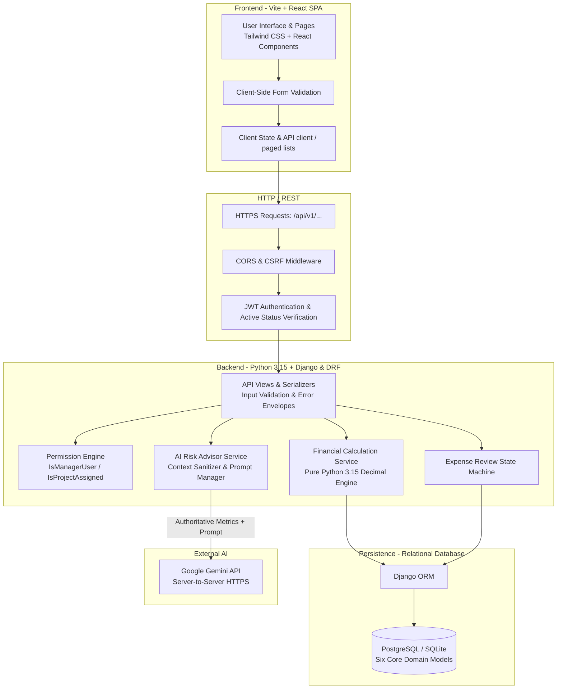
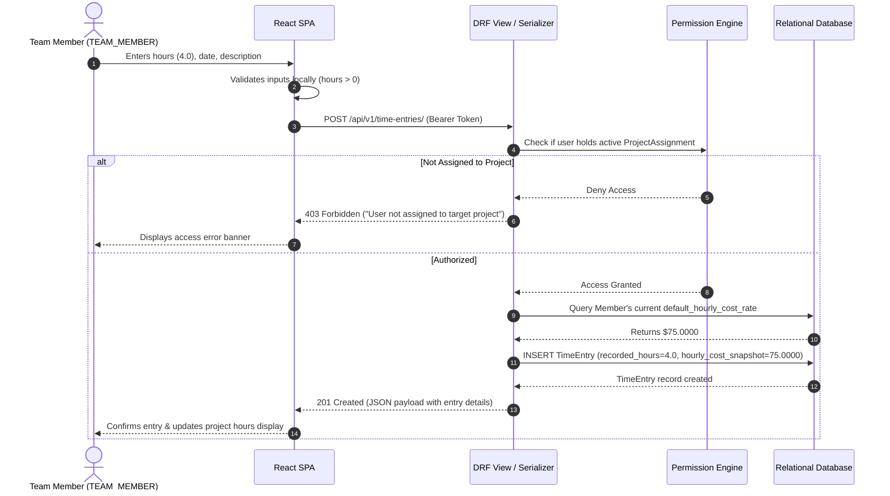

# MarginWatch — System Architecture & Technical Design

**Document Status:** Conceptual Architecture Specification (Phase 0)  
**Last Updated:** October 2026  
**Audience:** System Architects, Backend Engineers, Frontend Engineers  
**Architecture Authority:** [ADR-001: Initial Architecture](decisions/ADR-001-initial-architecture.md) | [ADR-002: Single-Agency Architecture](decisions/ADR-002-single-agency-architecture.md)  
**Financial Rules Authority:** [docs/financial-rules.md](financial-rules.md) | [ADR-003: Financial Rules](decisions/ADR-003-financial-rules-and-risk-classification.md)  
**Backend Apps & Models Blueprint:** [docs/backend/backend-apps-and-data-models.md](backend/backend-apps-and-data-models.md)

---

## 1. Architectural Overview & Philosophy

MarginWatch is built as a decoupled, full-stack web application adhering to a **backend-authoritative** architecture. The system is split cleanly between a Vite + React 19 single-page app (TypeScript, Tailwind CSS) and a Django REST Framework (DRF) backend service running on **Python 3.15**.

### 1.1 Single-Agency Architecture Law
- **One Agency Supported:** MarginWatch monitors project delivery profitability for **one software agency only** for this assessment MVP.
- **No Agency Table:** No `Agency`, `Tenant`, or `AgencyMembership` models exist in the database. The single operating agency is represented implicitly by the deployed application instance itself.
- **Application Roles:** Users hold one of two application roles: `MANAGER` or `TEAM_MEMBER`. Django's administrative flags (`is_staff`, `is_superuser`) serve strictly for Django admin site access, never as business application roles.
- **Project Assignments Control Access:** Team member access boundaries are governed by explicit `ProjectAssignment` records linking team members to projects.
- **Future Multi-Agency Out of Scope:** Multi-tenant SaaS capabilities are explicitly out of scope and must not introduce speculative abstractions or unused complexity into the codebase.

### 1.2 Core Architectural Tenets
1. **Backend as the Single Source of Truth:** All financial calculations, state transitions (e.g., expense reviews), permissions, and AI interactions occur strictly on the backend. The backend owns the authoritative financial calculation engine and deterministic risk classification. The frontend is strictly an interface for presentation and user interaction; it never calculates authoritative financials.
2. **Deterministic Calculations, Advisory AI:** Financial metrics (profitability, cost burn, budget overrun) are calculated using pure, deterministic algorithms with exact decimal arithmetic. AI is utilized solely as a read-only advisor to explain risk drivers and recommend operational interventions.
3. **Decoupled API Contract:** The frontend interacts with the backend strictly via standardized RESTful JSON endpoints (`/api/v1/`).
4. **Developer Simplicity:** The architecture avoids distributed complexity (microservices, event buses) in favor of a clean, modular backend service with clear domain separation.

---

## 2. System Architecture Diagram



---

## 3. Tier Responsibilities

### 3.1 Backend Responsibilities (Python 3.15, Django & DRF)
- **Identity & Access Control:** Manages user authentication, role enforcement (`MANAGER` vs. `TEAM_MEMBER`), and project assignment verification (`ProjectAssignment`).
- **Input Validation:** Enforces strict boundary validation on all payload attributes (e.g., non-negative amounts, maximum working hours per day).
- **Authoritative Financial Logic & Risk Watchdog:** Houses the pure Python calculation service implementing the formulas and precedence rules in [`docs/financial-rules.md`](financial-rules.md) using `decimal.Decimal`. The backend is solely responsible for determining project health (`over_budget`, `insufficient_data`, `at_risk`, `healthy`).
- **Expense State Machine:** Governs transitions from `PENDING` to `APPROVED` or `REJECTED`, logging author, reviewer, timestamps, and audit metadata.
- **AI Gateway & Context Assembly:** Packages verified financial metrics, strips sensitive PII, formats prompt payloads, calls the Google Gemini API, and validates the returned structured output.
- **Standardized Response Formatting:** Guarantees uniform JSON envelopes for both successful payloads and validation/system errors.

### 3.2 Frontend Responsibilities (Vite + React & TypeScript)
- **Presentation & Interaction:** Delivers an intuitive, accessible interface built with TypeScript and Tailwind CSS.
- **Frontend Visibility Does Not Replace Authorization:** Frontend conditional rendering (e.g., hiding a button or tab) is purely for usability; the backend authorizes every request independently.
- **Lifecycle & State Handling:** Explicitly manages and renders **loading**, **success**, **empty**, and **error** states for every asynchronous view.
- **Data Rendering:** Renders authoritative financial totals, health badges (`healthy`, `at_risk`, `over_budget`, `insufficient_data`), and burn rate indicators received from the backend.
- **AI Output Presentation:** Displays AI risk summaries and recommendations cleanly, distinctly visually labeled as "AI Advisory" to prevent confusion with deterministic metrics.

---

## 4. End-to-End Request Lifecycles

### 4.1 Time Entry Logging Flow


### 4.2 Financial Summary & AI Risk Advisory Flow
```mermaid
sequenceDiagram
    autonumber
    actor Mgr as Manager (MANAGER)
    participant FE as React SPA
    participant API as DRF Financial View
    participant FinSvc as Financial Calculation Service (Python 3.15)
    participant AISvc as AI Advisor Service
    participant Gemini as Google Gemini API
    participant DB as Relational Database

    Mgr->>FE: Navigates to Project Financials Page
    FE->>API: GET /api/v1/projects/{id}/financial-summary/
    API->>DB: Fetch Project baselines, TimeEntries, Approved Expenses
    DB-->>API: Raw financial dataset
    API->>FinSvc: calculate_project_financials(dataset)
    FinSvc-->>API: Deterministic metrics & status (e.g., at_risk)
    API-->>FE: 200 OK (Authoritative metrics payload)
    FE-->>Mgr: Displays metrics, health badge, burn rate

    opt Trigger AI Advisory
        Mgr->>FE: Clicks "Generate AI Risk Analysis"
        FE->>API: POST /api/v1/projects/{id}/ai-risk-analysis/
        API->>FinSvc: calculate_project_financials(dataset)
        FinSvc-->>API: Verified metrics
        API->>AISvc: generate_risk_advice(metrics)
        AISvc->>AISvc: Strip PII & build structured prompt
        AISvc->>Gemini: HTTPS POST generateContent (model from GEMINI_MODEL, default gemini-3.8-flash)
        alt Gemini Succeeds
            Gemini-->>AISvc: Returns structured JSON (drivers, recommendations)
            AISvc-->>API: Validated advisory payload
            API-->>FE: 200 OK (Structured advisory)
            FE-->>Mgr: Displays recommendations & risk drivers
        else Gemini Times Out / Quota Exceeded
            Gemini-->>AISvc: Error / 429 / Timeout
            AISvc-->>API: Graceful fallback error
            API-->>FE: 503 Service Unavailable ("AI Advisory temporarily unavailable")
            FE-->>Mgr: Shows fallback alert; deterministic metrics remain intact
        end
    end
```

---

## 5. Error Handling Conventions

All API responses follow a predictable JSON error schema. Internal system errors never leak stack traces to the client in production.

### Standard Error Envelope Format
```json
{
  "error": {
    "code": "VALIDATION_ERROR",
    "message": "The submitted payload contains one or more invalid attributes.",
    "details": [
      {
        "field": "recorded_hours",
        "issue": "Recorded hours must be a positive number less than or equal to 24.0."
      }
    ]
  }
}
```

### HTTP Status Code Usage
| HTTP Status | Semantic Usage in MarginWatch |
| :--- | :--- |
| `200 OK` | Successful query or read operation. |
| `201 Created` | Successful creation of an entity (TimeEntry, Expense, Project). |
| `204 No Content` | Successful deletion or revocation of a resource. |
| `400 Bad Request` | Payload syntax error, negative financial value, or schema violation. |
| `401 Unauthorized` | Missing, expired, or invalid authentication token. |
| `403 Forbidden` | Valid authentication, but insufficient role or unauthorized project access. |
| `404 Not Found` | Requested resource does not exist or user lacks permission to view it. |
| `422 Unprocessable`| Business logic violation (e.g., attempting to re-approve an already approved expense). |
| `502 / 503 / 504` | External dependency failure (e.g., Gemini API timeout or rate limit). |

---

## 6. Security Boundaries & Secrets Encapsulation

```
[ Browser / Public Internet ]
           │
           │ HTTPS
           ▼
[ Frontend (static Vite build / dev server) ]
  • Exposed ENV: VITE_API_BASE_URL only (optional)
  • Zero access to database credentials or Gemini API keys
           │
           │ HTTPS / REST (/api/v1/...)
           ▼
[ Backend Server (Python 3.15 + Django / DRF) ]
  • Private ENV: DJANGO_SECRET_KEY, DATABASE_URL, GEMINI_API_KEY
  • Enforces Authentication, RBAC, and Object-Level Access (ProjectAssignment)
           │
     ┌─────┴───────────────────────┐
     │ Internal Private Network    │ Server-to-Server HTTPS
     ▼                             ▼
[ Relational Database (PostgreSQL / SQLite) ]  [ Google Gemini API ]
```

1. **Isolation of AI Credentials:** The Google Gemini API key resides solely in the Django backend `.env`. It is never transmitted across the wire to the frontend client.
2. **CORS & CSRF Defenses:** Django's `django-cors-headers` middleware whitelist restricts API consumption strictly to authorized origin domains (`http://localhost:3000`).
3. **Token Security:** Signed JWT access tokens are transmitted via standard HTTP `Authorization: Bearer <token>` headers.
