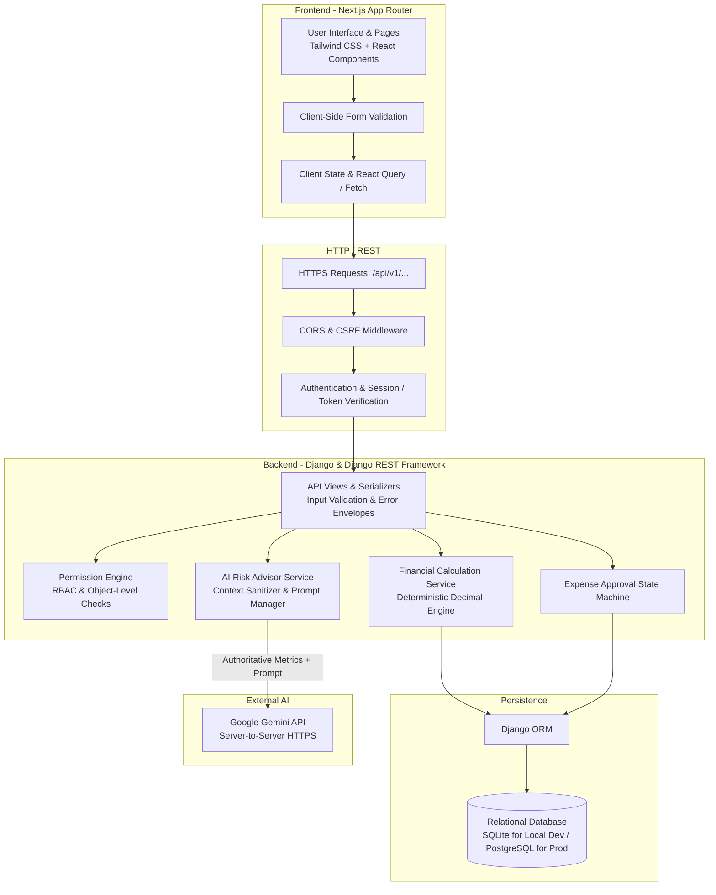
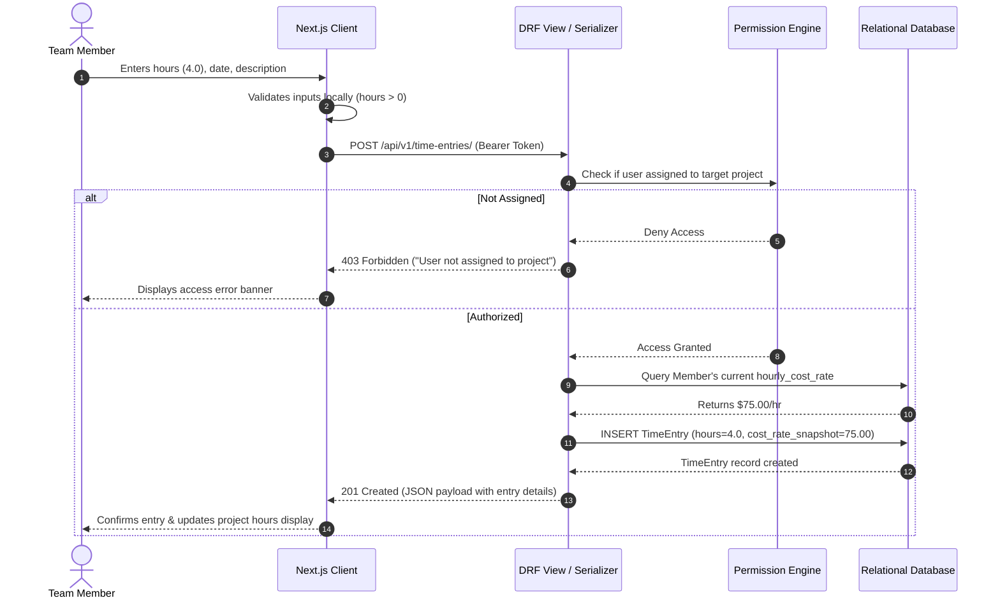

# MarginWatch — System Architecture & Technical Design

**Document Status:** Conceptual Architecture Specification (Phase 0)  
**Last Updated:** October 2026  
**Audience:** System Architects, Backend Engineers, Frontend Engineers  

---

## 1. Architectural Overview & Philosophy

MarginWatch is designed as a decoupled, full-stack web application adhering to a **backend-authoritative** architecture. The system is split cleanly between a modern Next.js client interface and a robust Django REST Framework (DRF) backend service.

### Fundamental Architectural Tenets
1. **Backend as the Single Source of Truth:** All financial calculations, state transitions (e.g., expense approvals), permissions, and AI interactions occur strictly on the backend. The frontend is an interface for presentation and user interaction; it never calculates authoritative financials.
2. **Deterministic Calculations, Advisory AI:** Financial metrics (profitability, cost burn, budget overrun) are calculated using pure, deterministic algorithms. AI is utilized solely as a read-only advisor to explain risk drivers and recommend operational interventions.
3. **Decoupled API Contract:** The frontend interacts with the backend strictly via standardized RESTful JSON endpoints (`/api/v1/`).
4. **Developer Simplicity:** The architecture avoids distributed complexity (microservices, event buses) in favor of a clean, monolithic backend service with modular domain separation.

---

## 2. System Architecture Diagram



---

## 3. Tier Responsibilities

### 3.1 Backend Responsibilities (Django & DRF)
- **Identity & Access Control:** Manages user authentication, role assignment (`AGENCY_MANAGER` vs. `TEAM_MEMBER`), and enforces object-level access boundaries.
- **Input Validation:** Enforces strict boundary validation on all payload attributes (e.g., non-negative amounts, maximum working hours per day).
- **Authoritative Financial Logic:** Houses the pure Python calculation service implementing the formulas in [`docs/financial-rules.md`](financial-rules.md) using `Decimal`.
- **Expense State Machine:** Governs transitions from `PENDING` to `APPROVED` or `REJECTED`, logging author, reviewer, timestamps, and audit metadata.
- **AI Gateway & Context Assembly:** Packages verified financial metrics, strips sensitive PII, formats prompt payloads, calls the Google Gemini API, and validates the returned structured output.
- **Standardized Response Formatting:** Guarantees uniform JSON envelopes for both successful payloads and validation/system errors.

### 3.2 Frontend Responsibilities (Next.js)
- **Presentation & Interaction:** Delivers an intuitive, accessible interface built with TypeScript and Tailwind CSS.
- **Usability Validation:** Provides immediate client-side form feedback (e.g., preventing empty fields or alphanumeric hours) before submitting requests to reduce round-trips.
- **Lifecycle & State Handling:** Explicitly manages and renders **loading**, **success**, **empty**, and **error** states for every asynchronous view.
- **Data Rendering:** Renders authoritative financial totals, health badges (`HEALTHY`, `AT_RISK`, `OVER_BUDGET`, `INSUFFICIENT_DATA`), and chart visualizations.
- **AI Output Presentation:** Displays AI risk summaries and recommendations cleanly, distinctly visually labeled as "AI Advisory" to prevent confusion with deterministic metrics.

---

## 4. End-to-End Request Lifecycles

### 4.1 Time Entry Logging Flow


### 4.2 Financial Summary & AI Risk Advisory Flow
```mermaid
sequenceDiagram
    autonumber
    actor Manager as Agency Manager
    participant FE as Next.js Client
    participant API as DRF Financial View
    participant FinSvc as Financial Calculation Service
    participant AISvc as AI Advisor Service
    participant Gemini as Google Gemini API
    participant DB as Relational Database

    Manager->>FE: Navigates to Project Financials Page
    FE->>API: GET /api/v1/projects/{id}/financial-summary/
    API->>DB: Fetch Project baselines, TimeEntries, Approved Expenses
    DB-->>API: Raw financial dataset
    API->>FinSvc: calculate_project_financials(dataset)
    FinSvc-->>API: Deterministic metrics & status (e.g., AT_RISK)
    API-->>FE: 200 OK (Authoritative metrics payload)
    FE-->>Manager: Displays metrics, health badge, burn rate

    opt Trigger AI Advisory
        Manager->>FE: Clicks "Generate AI Risk Analysis"
        FE->>API: POST /api/v1/projects/{id}/ai-risk-analysis/
        API->>FinSvc: calculate_project_financials(dataset)
        FinSvc-->>API: Verified metrics
        API->>AISvc: generate_risk_advice(metrics)
        AISvc->>AISvc: Strip PII & build structured prompt
        AISvc->>Gemini: HTTPS POST /v1beta/models/gemini-2.5-flash:generateContent
        alt Gemini Succeeds
            Gemini-->>AISvc: Returns structured JSON (drivers, recommendations)
            AISvc-->>API: Validated advisory payload
            API-->>FE: 200 OK (Structured advisory)
            FE-->>Manager: Displays recommendations & risk drivers
        else Gemini Times Out / Quota Exceeded
            Gemini-->>AISvc: Error / 429 / Timeout
            AISvc-->>API: Graceful fallback error
            API-->>FE: 503 Service Unavailable ("AI Advisory temporarily unavailable")
            FE-->>Manager: Shows fallback alert; deterministic metrics remain intact
        end
    end
```

---

## 5. Error Handling Conventions

All API responses follow a predictable JSON error schema. Internal system errors (e.g., database connection failures, unhandled exceptions) never leak stack traces to the client in production.

### Standard Error Envelope Format
```json
{
  "error": {
    "code": "VALIDATION_ERROR",
    "message": "The submitted payload contains one or more invalid attributes.",
    "details": [
      {
        "field": "hours_worked",
        "issue": "Hours worked must be a positive number less than or equal to 24.0."
      }
    ]
  }
}
```

### HTTP Status Code Usage
| HTTP Status | Semantic Usage in MarginWatch |
| :--- | :--- |
| `200 OK` | Successful query or read operation. |
| `201 Created` | Successful creation of an entity (TimeEntry, Expense, Project). |
| `204 No Content` | Successful deletion of an unbilled resource. |
| `400 Bad Request` | Payload syntax error, negative financial value, or schema violation. |
| `401 Unauthorized` | Missing or invalid authentication token. |
| `403 Forbidden` | Valid authentication, but insufficient role or unauthorized project access. |
| `404 Not Found` | Requested resource does not exist or user lacks permission to see it exists. |
| `422 Unprocessable`| Business logic violation (e.g., attempting to approve an already approved expense). |
| `502 / 503 / 504` | External dependency failure (e.g., Gemini API timeout or rate limit). |

---

## 6. Security Boundaries & Secrets Encapsulation

```
[ Browser / Public Internet ]
           │
           │ HTTPS
           ▼
[ Frontend Server (Next.js) ]
  • Exposed ENV: NEXT_PUBLIC_API_BASE_URL only
  • Zero access to database credentials or Gemini API keys
           │
           │ HTTPS / REST (/api/v1/...)
           ▼
[ Backend Server (Django / DRF) ]
  • Private ENV: DJANGO_SECRET_KEY, DB_PASSWORD, GEMINI_API_KEY
  • Enforces Authentication, RBAC, and Object-Level Access
           │
     ┌─────┴───────────────────────┐
     │ Internal Private Network    │ Server-to-Server HTTPS
     ▼                             ▼
[ Relational Database ]     [ Google Gemini API ]
```

1. **Isolation of AI Credentials:** The Google Gemini API key resides solely in the Django backend `.env`. It is never transmitted across the wire to the frontend client.
2. **CORS & CSRF Defenses:** Django's `django-cors-headers` middleware whitelist restricts API consumption strictly to authorized origin domains (e.g., `http://localhost:3000` during local development).
3. **Session / Token Security:** Tokens are transmitted via standard HTTP `Authorization` headers. Cookies, where used, are configured with `HttpOnly`, `SameSite=Lax`, and `Secure` attributes in production.

---

## 7. Development Environment & Migration Path

### Local Development (Phases 1–7)
- **Frontend:** Next.js development server running on port `3000`.
- **Backend:** Django development server (`manage.py runserver`) running on port `8000`.
- **Database:** Local file-based SQLite (`db.sqlite3`). This enables instant setup without requiring Docker or a dedicated database daemon during early prototyping.

### Production Path (Phase 8+)
- **Database Transition:** The Django ORM models are written to be database-agnostic. Transitioning to PostgreSQL requires updating `DATABASES` settings in `settings.py` and running `manage.py migrate` without altering application business logic.
- **Static & Media Files:** Configured for WhiteNoise or cloud storage buckets (e.g., AWS S3).
- **Containerization:** Clean Dockerfiles for both frontend (Node standalone) and backend (Gunicorn/Uvicorn).
