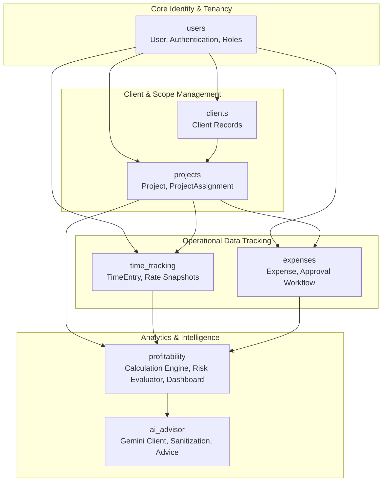
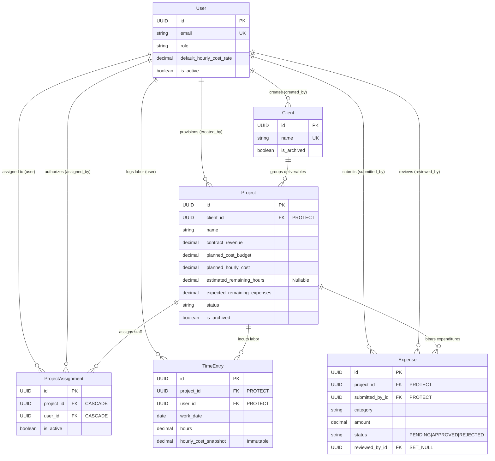
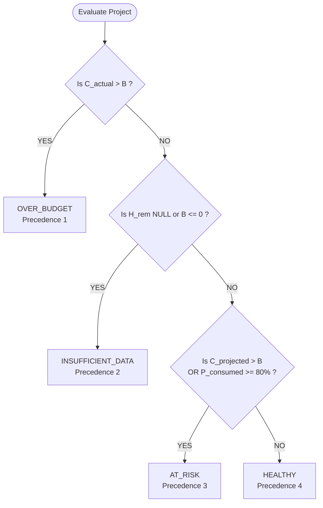
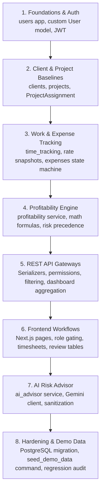

# MarginWatch — Backend Apps & Data Models Blueprint

**Document Status:** Implementation Blueprint & Long-Term Source of Truth (Phase 0)  
**Last Updated:** October 2026  
**Target Runtime:** Python 3.15 / Django 5.x / Django REST Framework 3.15+  
**Architecture Authorities:**  
- [ADR-001: Initial Architecture & Technology Stack](../decisions/ADR-001-initial-architecture.md)  
- [ADR-002: Single-Agency Architecture](../decisions/ADR-002-single-agency-architecture.md)  
- [ADR-003: Financial Rules & Calculation Specifications](../decisions/ADR-003-financial-rules-and-risk-classification.md)  
- [Conceptual Data Model & ERD](../data-model.md)  
- [Security & Permissions Specification](../security-and-permissions.md)  
- [API Specification Contract](../api-specification.md)

---

## 1. Document Purpose and Project Context

### 1.1 Purpose of this Document
This document is the authoritative, implementation-ready architectural blueprint for the MarginWatch Django backend. It specifies the modular Django application structure, database models, fields, constraints, deletion behaviors, service boundaries, permissions, financial calculation algorithms, and test requirements. 

Any software engineer returning to this codebase days or weeks after initial planning must be able to consult this document before creating or modifying any model, serializer, view, service, or migration without needing to reconstruct past design discussions.

### 1.2 What MarginWatch Does
MarginWatch is a dedicated project profitability and delivery-cost watchdog. It was designed specifically for small- to mid-sized software agencies delivering custom client projects under fixed-price contracts or capped budgets.

In software agency delivery operations, profitability is routinely compromised when recorded labor hours and direct expenses accumulate silently between billing milestones. By the time an overrun is discovered during month-end invoicing, the agency has already absorbed an irrecoverable operating loss.

### 1.3 The Core Business Question MarginWatch Answers
> *"Based on recorded work hours, approved expenses, and estimated remaining work, is this project likely to exceed its planned delivery-cost budget?"*

### 1.4 Single-Agency Architectural Law
MarginWatch is **not a multi-tenant SaaS platform**. It is architected for **one agency only**, represented implicitly by the deployed application instance itself (see [ADR-002](../decisions/ADR-002-single-agency-architecture.md)).
- No `Agency`, `Tenant`, or `AgencyMembership` database models exist.
- No `agency_id` attributes are accepted or required in API request bodies, headers, or query parameters.
- Multi-tenancy abstractions are strictly out of scope for this assessment MVP and must not introduce speculative complexity into the codebase.

### 1.5 Technology Stack
- **Backend:** Python 3.15, Django, and Django REST Framework (DRF).
- **Frontend:** Next.js (App Router), TypeScript, and Tailwind CSS.
- **Database Strategy:** SQLite for rapid, zero-dependency local development and automated testing; PostgreSQL for production deployment (Phase 8+).
- **AI Advisory Layer:** Google Gemini API (`gemini-2.5-flash`), accessed strictly server-to-server from the Django backend.

### 1.6 Backend Authority Principle
The Django backend is the **sole authoritative source of truth** for:
1. User identity, authentication, and application role enforcement (`MANAGER` vs. `TEAM_MEMBER`).
2. Object-level access control and project assignment validation.
3. Immutable rate snapshot preservation.
4. Deterministic financial calculations and fixed-point decimal arithmetic.
5. Project risk classification hierarchy evaluation.
6. Context sanitization and grounding for AI advice.

The frontend is a decoupled presentation client. Frontend route guards and conditional UI rendering are provided solely for user experience; **they are never treated as security or authorization mechanisms**.

---

## 2. Backend App Structure

Rather than creating a monolithic backend or an over-engineered micro-app for every single model, the backend is organized into **seven cohesive Django applications**, grouped strictly by operational domain and lifecycle responsibility.



### App Breakdown & Module Responsibilities

| App Name | Primary Purpose | Models Owned | Business Logic Owned | API Responsibilities | Dependencies | Enforced Permissions | Logic That Must Not Be Duplicated Elsewhere |
| :--- | :--- | :--- | :--- | :--- | :--- | :--- | :--- |
| **`users`** | User identity, authentication, roles, and base employee wage rates. | `User` (Custom User Model) | User creation, role validation, password hashing, hourly rate management. | `/api/v1/auth/login/`<br/>`/api/v1/auth/refresh/`<br/>`/api/v1/auth/logout/`<br/>`/api/v1/auth/me/`<br/>`/api/v1/users/` | Django Auth | `IsAuthenticated`<br/>`IsManager` (for role/rate edits) | Verification that a user is active; role assignment governance; self-elevation prevention. |
| **`clients`** | Commercial client account directory. | `Client` | Client lifecycle, archiving, contact metadata maintenance. | `/api/v1/clients/` | `users` | `IsAuthenticated`<br/>`IsManager` | Soft-archiving query filtering; deletion protection when projects are linked. |
| **`projects`** | Delivery project baselines, budgets, revenues, and team assignments. | `Project`<br/>`ProjectAssignment` | Project budgeting, scope estimate validation, team member assignment and revocation. | `/api/v1/projects/`<br/>`/api/v1/projects/{id}/assignments/` | `users`<br/>`clients` | `IsAuthenticated`<br/>`IsManager`<br/>`IsAssignedTeamMember` | Assignment uniqueness validation; project deadline consistency check; baseline revenue/budget updates. |
| **`time_tracking`** | Recording labor effort and capturing historical wage rates. | `TimeEntry` | Work date validation, hour constraints ($0 < H \le 24$), rate snapshot capture from `User`. | `/api/v1/time-entries/`<br/>`/api/v1/projects/{id}/time-entries/` | `users`<br/>`projects` | `IsAuthenticated`<br/>`IsAssignedTeamMember`<br/>`IsOwnerOrManager` | Snapshot population (`hourly_cost_snapshot = user.default_hourly_cost_rate`); immutability of historical snapshots. |
| **`expenses`** | Direct non-labor expenditures and manager review lifecycle. | `Expense` | Two-stage approval state machine (`PENDING` $\rightarrow$ `APPROVED`/`REJECTED`), self-approval blocking. | `/api/v1/expenses/`<br/>`/api/v1/projects/{id}/expenses/`<br/>`/api/v1/expenses/{id}/review/` | `users`<br/>`projects` | `IsAuthenticated`<br/>`IsAssignedTeamMember`<br/>`IsManager` (for review) | Approval state transitions; mandatory rejection note enforcement; immutability of approved/rejected amounts. |
| **`profitability`** | Authoritative financial calculations, risk evaluation, and dashboard aggregations. | *None (Pure Service & Query Layer)* | All 8 financial formulas, division-by-zero protection, 4-tier risk precedence hierarchy. | `/api/v1/projects/{id}/financial-summary/`<br/>`/api/v1/projects/{id}/financials/`<br/>`/api/v1/projects/{id}/risk/`<br/>`/api/v1/dashboard/summary/` | `projects`<br/>`time_tracking`<br/>`expenses` | `IsAuthenticated`<br/>`IsManager` (financial visibility) | The 8 financial formulas; precedence hierarchy; currency formatting; portfolio budget health rollups. |
| **`ai_advisor`** | LLM-powered plain-language project risk explanations and operational mitigations. | *None (Ephemeral in MVP)* | Context sanitization, prompt construction, Gemini API communication, schema validation, fallback handler. | `/api/v1/projects/{id}/ai-risk-analysis/`<br/>`/api/v1/projects/{id}/ai-advice/` | `profitability`<br/>`projects` | `IsAuthenticated`<br/>`IsManager` | PII scrubbing; temperature and token bounds; JSON schema output enforcement; failure mode decoupling. |

> [!NOTE]
> **Dashboard App Justification:** Dashboard aggregations initially reside within the `profitability` app (`/api/v1/dashboard/summary/`). A dedicated `dashboard` app is unnecessary for the assessment MVP and would introduce premature abstraction. If future reporting introduces multi-currency hedging, executive exports, or cross-departmental widgets, an independent `dashboard` app can be justified.

---

## 3. Complete Model Specifications

All database tables are governed by the following global technical standards:
- **Decimal Safety:** All monetary amounts use `DecimalField(max_digits=12, decimal_places=2)`. All hour quantities use `DecimalField(max_digits=8, decimal_places=2)`. Hourly cost rates use `DecimalField(max_digits=10, decimal_places=4)`. Floating-point fields (`FloatField`) are strictly prohibited.
- **Audit Timestamps:** Every business entity includes auto-populated `created_at = models.DateTimeField(auto_now_add=True)` and `updated_at = models.DateTimeField(auto_now=True)`.
- **Deletion Defense:** Every relationship involving financial history uses `on_delete=models.PROTECT`. Cascading deletes (`CASCADE`) are restricted to pure junction tables (`ProjectAssignment`).

---

### 3.1 Model: `User`
- **Owning App:** `users`
- **Purpose:** Represents an authenticated agency staff member, establishes their application authorization role (`MANAGER` or `TEAM_MEMBER`), and stores their internal base hourly labor cost rate.

| Attribute Name | Django Field Type | Null / Blank | Default Value | Validation & Constraints | Relationship & Deletion | Read / Modify Permissions |
| :--- | :--- | :---: | :---: | :--- | :--- | :--- |
| `id` | `UUIDField` or `BigAutoField` | Null: No<br/>Blank: No | Auto-generated | Primary Key. Open architectural choice (see [Section 11](#11-open-decisions-register)). | Primary Key | Read: Authenticated User<br/>Modify: Immutable |
| `email` | `EmailField(max_length=254)` | Null: No<br/>Blank: No | None | Unique constraint; RFC 5322 compliant; normalized to lowercase. Primary login identifier. | None | Read: Authenticated User<br/>Modify: User (self) / Manager |
| `username` | `CharField(max_length=150)` | Null: Yes<br/>Blank: Yes | None | Optional or unique depending on login decision (`DEC-AUTH-01`). | None | Read: Authenticated User<br/>Modify: User (self) / Manager |
| `first_name` | `CharField(max_length=100)` | Null: No<br/>Blank: No | None | Human given name; non-empty. | None | Read: Authenticated User<br/>Modify: User (self) / Manager |
| `last_name` | `CharField(max_length=100)` | Null: No<br/>Blank: No | None | Human surname; non-empty. | None | Read: Authenticated User<br/>Modify: User (self) / Manager |
| `role` | `CharField(max_length=20)` | Null: No<br/>Blank: No | `'TEAM_MEMBER'` | Choices: `Role.MANAGER` (`'MANAGER'`), `Role.TEAM_MEMBER` (`'TEAM_MEMBER'`). | None | Read: Authenticated User<br/>Modify: **Manager Only** |
| `default_hourly_cost_rate` | `DecimalField(max_digits=10, decimal_places=4)` | Null: No<br/>Blank: No | `Decimal('0.0000')` | Min value validator: $\ge 0.0000$. Internal direct labor cost to agency. | None | Read: **Manager Only**<br/>Modify: **Manager Only** |
| `is_active` | `BooleanField` | Null: No<br/>Blank: No | `True` | Inactive users are strictly blocked from obtaining or refreshing JWT tokens. | None | Read: Authenticated User<br/>Modify: **Manager Only** |
| `is_staff` | `BooleanField` | Null: No<br/>Blank: No | `False` | Django administration portal access flag. | None | Read: Admin / Superuser<br/>Modify: Superuser Only |
| `is_superuser` | `BooleanField` | Null: No<br/>Blank: No | `False` | Unrestricted Django admin permissions. | None | Read: Superuser Only<br/>Modify: Superuser Only |
| `date_joined` | `DateTimeField` | Null: No<br/>Blank: No | `timezone.now` | Account registration timestamp. | None | Read: Authenticated User<br/>Modify: Immutable |
| `created_at` | `DateTimeField` | Null: No<br/>Blank: No | `auto_now_add=True` | Record creation timestamp. | None | Read: Authenticated User<br/>Modify: Immutable |
| `updated_at` | `DateTimeField` | Null: No<br/>Blank: No | `auto_now=True` | Record update timestamp. | None | Read: Authenticated User<br/>Modify: Immutable |

#### Implementation & Governance Notes:
1. **Custom User Model Mandate:** MarginWatch must inherit from `AbstractBaseUser` and `PermissionsMixin` prior to executing the initial database migration (`AUTH_USER_MODEL = 'users.User'`). Swapping the user model mid-project corrupts foreign key migrations.
2. **Administrative Flags vs. Application Roles:** `is_staff` and `is_superuser` grant operational access to Django's built-in `/admin/` portal. They are **never** evaluated by application business logic or REST API permission classes. All business permissions inspect `user.role`.
3. **Self-Elevation Prevention:** A team member updating their profile (`PATCH /api/v1/auth/me/`) must use a serializer that excludes `role`, `default_hourly_cost_rate`, `is_active`, `is_staff`, and `is_superuser`. Any attempted elevation returns HTTP 400 Bad Request.
4. **Wage Masking:** `default_hourly_cost_rate` must never appear in serializers consumed by `TEAM_MEMBER` users. Colleague salaries are strictly confidential.

---

### 3.2 Model: `Client`
- **Owning App:** `clients`
- **Purpose:** Represents a commercial customer or organization contracting the software agency for project delivery.

| Attribute Name | Django Field Type | Null / Blank | Default Value | Validation & Constraints | Relationship & Deletion | Read / Modify Permissions |
| :--- | :--- | :---: | :---: | :--- | :--- | :--- |
| `id` | `UUIDField` or `BigAutoField` | Null: No<br/>Blank: No | Auto-generated | Primary Key. | Primary Key | Read: Manager / Assigned Member<br/>Modify: Immutable |
| `name` | `CharField(max_length=200)` | Null: No<br/>Blank: No | None | Unique constraint; non-empty trimmed string. | None | Read: Manager / Assigned Member<br/>Modify: **Manager Only** |
| `contact_name` | `CharField(max_length=150)` | Null: Yes<br/>Blank: Yes | None | Primary business representative name. | None | Read: **Manager Only**<br/>Modify: **Manager Only** |
| `contact_email` | `EmailField(max_length=254)` | Null: Yes<br/>Blank: Yes | None | Primary billing or communications email. | None | Read: **Manager Only**<br/>Modify: **Manager Only** |
| `contact_phone` | `CharField(max_length=50)` | Null: Yes<br/>Blank: Yes | None | Commercial phone contact. | None | Read: **Manager Only**<br/>Modify: **Manager Only** |
| `notes` | `TextField` | Null: Yes<br/>Blank: Yes | None | Internal agency account notes and contract history. | None | Read: **Manager Only**<br/>Modify: **Manager Only** |
| `created_by` | `ForeignKey('users.User')` | Null: Yes<br/>Blank: True | None | Manager who registered the client. | `on_delete=models.SET_NULL` | Read: Manager<br/>Modify: Immutable |
| `is_archived` | `BooleanField` | Null: No<br/>Blank: No | `False` | Soft-archiving flag. Excluded from active dropdowns. | None | Read: Manager<br/>Modify: **Manager Only** |
| `created_at` | `DateTimeField` | Null: No<br/>Blank: No | `auto_now_add=True` | Record creation timestamp. | None | Read: Manager<br/>Modify: Immutable |
| `updated_at` | `DateTimeField` | Null: No<br/>Blank: No | `auto_now=True` | Record update timestamp. | None | Read: Manager<br/>Modify: Immutable |

#### Implementation & Governance Notes:
1. **One-to-Many Relationship:** One client can have many projects (`related_name='projects'`).
2. **Deletion Protection:** Deletion of a client record is strictly prohibited (`PROTECT`) if linked projects exist. Decommissioning is performed exclusively via `is_archived = True`.
3. **Scattered Metadata Protection:** Team members cannot list all agency clients. Client name is exposed to team members only as contextual metadata embedded within their assigned projects.

---

### 3.3 Model: `Project`
- **Owning App:** `projects`
- **Purpose:** The core delivery monitoring entity containing commercial contract baselines, cost ceilings, labor estimation rates, remaining scope estimates, and delivery lifecycle states.

| Attribute Name | Django Field Type | Null / Blank | Default Value | Validation & Constraints | Relationship & Deletion | Read / Modify Permissions |
| :--- | :--- | :---: | :---: | :--- | :--- | :--- |
| `id` | `UUIDField` or `BigAutoField` | Null: No<br/>Blank: No | Auto-generated | Primary Key. | Primary Key | Read: Manager / Assigned Member<br/>Modify: Immutable |
| `client` | `ForeignKey('clients.Client')` | Null: No<br/>Blank: No | None | References the commercial client. Must be an active client. | `on_delete=models.PROTECT`, `related_name='projects'` | Read: Manager / Assigned Member<br/>Modify: **Manager Only** |
| `name` | `CharField(max_length=200)` | Null: No<br/>Blank: No | None | Descriptive project name; non-empty. | None | Read: Manager / Assigned Member<br/>Modify: **Manager Only** |
| `description` | `TextField` | Null: Yes<br/>Blank: True | None | Delivery scope summary and deliverables. | None | Read: Manager / Assigned Member<br/>Modify: **Manager Only** |
| `contract_revenue` | `DecimalField(max_digits=12, decimal_places=2)` | Null: No<br/>Blank: No | `Decimal('0.00')` | Min value validator: $\ge 0.00$. Fixed-price revenue cap. | None | Read: **Manager Only**<br/>Modify: **Manager Only** |
| `planned_cost_budget` | `DecimalField(max_digits=12, decimal_places=2)` | Null: No<br/>Blank: No | None | Min value validator: $> 0.00$. Strictly positive internal cost ceiling ($B$). | None | Read: **Manager Only**<br/>Modify: **Manager Only** |
| `planned_hourly_cost` | `DecimalField(max_digits=10, decimal_places=4)` | Null: No<br/>Blank: No | None | Min value validator: $> 0.00$. Blended labor rate used to value remaining hours ($C_{hourly\_plan}$). | None | Read: **Manager Only**<br/>Modify: **Manager Only** |
| `currency` | `CharField(max_length=3)` | Null: No<br/>Blank: No | `'USD'` | ISO 4217 uppercase 3-letter currency code. | None | Read: Manager / Assigned Member<br/>Modify: **Manager Only** |
| `estimated_remaining_hours` | `DecimalField(max_digits=8, decimal_places=2)` | **Null: Yes**<br/>**Blank: True** | **`None`** | **Critical:** `null` = estimate unknown; `0.00` = scope complete. Min validator: $\ge 0.00$ when not null. | None | Read: Manager / Assigned Member<br/>Modify: **Manager Only** |
| `expected_remaining_expenses` | `DecimalField(max_digits=12, decimal_places=2)` | Null: No<br/>Blank: No | `Decimal('0.00')` | Min value validator: $\ge 0.00$. Un-incurred future direct expenses ($E_{rem}$). | None | Read: **Manager Only**<br/>Modify: **Manager Only** |
| `status` | `CharField(max_length=20)` | Null: No<br/>Blank: No | `'PLANNING'` | Choices: `ProjectStatus.PLANNING`, `ACTIVE`, `ON_HOLD`, `COMPLETED`, `CANCELLED`. | None | Read: Manager / Assigned Member<br/>Modify: **Manager Only** |
| `start_date` | `DateField` | Null: Yes<br/>Blank: True | None | Scheduled kickoff date. | None | Read: Manager / Assigned Member<br/>Modify: **Manager Only** |
| `deadline` | `DateField` | Null: Yes<br/>Blank: True | None | Target delivery date. Validation: `deadline >= start_date` if both are set. | None | Read: Manager / Assigned Member<br/>Modify: **Manager Only** |
| `created_by` | `ForeignKey('users.User')` | Null: Yes<br/>Blank: True | None | Manager who provisioned the project record. | `on_delete=models.SET_NULL` | Read: Manager<br/>Modify: Immutable |
| `is_archived` | `BooleanField` | Null: No<br/>Blank: No | `False` | Soft-archiving flag. Excluded from default active lists. | None | Read: Manager<br/>Modify: **Manager Only** |
| `created_at` | `DateTimeField` | Null: No<br/>Blank: No | `auto_now_add=True` | Record creation timestamp. | None | Read: Manager / Assigned Member<br/>Modify: Immutable |
| `updated_at` | `DateTimeField` | Null: No<br/>Blank: No | `auto_now=True` | Record update timestamp. | None | Read: Manager / Assigned Member<br/>Modify: Immutable |

#### Implementation & Governance Notes:
1. **Revenue vs. Cost Budget:** `contract_revenue` ($R$, money client pays agency) and `planned_cost_budget` ($B$, internal cost ceiling agency expects to spend) are fundamentally distinct concepts. Never conflate them.
2. **Strict Estimate Semantics:** `estimated_remaining_hours` must permit true database `NULL`. A value of `0.00` explicitly asserts that the team has completed 100% of scope deliverables. An unestimated project must store `null` so the financial engine can trigger `INSUFFICIENT_DATA`.
3. **Forecast Input Distinction:** `expected_remaining_expenses` is a *forward-looking forecast input*, not an incurred expenditure. It is excluded from actual costs and included only in projected final costs.
4. **Serializer Field Masking:** When serialized for `TEAM_MEMBER`, the serializer must strip `contract_revenue`, `planned_cost_budget`, `planned_hourly_cost`, `expected_remaining_expenses`, and all profit/margin calculations.

---

### 3.4 Model: `ProjectAssignment`
- **Owning App:** `projects`
- **Purpose:** Connects eligible team members to projects, establishing the authoritative object-level access control boundary.

| Attribute Name | Django Field Type | Null / Blank | Default Value | Validation & Constraints | Relationship & Deletion | Read / Modify Permissions |
| :--- | :--- | :---: | :---: | :--- | :--- | :--- |
| `id` | `UUIDField` or `BigAutoField` | Null: No<br/>Blank: No | Auto-generated | Primary Key. | Primary Key | Read: Manager / Assigned Member<br/>Modify: Immutable |
| `project` | `ForeignKey('projects.Project')` | Null: No<br/>Blank: No | None | References the project. | `on_delete=models.CASCADE`, `related_name='assignments'` | Read: Manager / Assigned Member<br/>Modify: **Manager Only** |
| `user` | `ForeignKey('users.User')` | Null: No<br/>Blank: No | None | References the assigned user. Must have `is_active=True` and `role='TEAM_MEMBER'`. | `on_delete=models.CASCADE`, `related_name='project_assignments'` | Read: Manager / Assigned Member<br/>Modify: **Manager Only** |
| `assigned_by` | `ForeignKey('users.User')` | Null: Yes<br/>Blank: True | None | Manager who executed the assignment. | `on_delete=models.SET_NULL` | Read: Manager<br/>Modify: Immutable |
| `assigned_at` | `DateTimeField` | Null: No<br/>Blank: No | `auto_now_add=True` | Assignment creation timestamp. | None | Read: Manager / Assigned Member<br/>Modify: Immutable |
| `is_active` | `BooleanField` | Null: No<br/>Blank: No | `True` | If `False`, team member access is revoked while preserving historical audit logs. | None | Read: Manager / Assigned Member<br/>Modify: **Manager Only** |

#### Implementation & Governance Notes:
1. **Database Uniqueness Constraint:** The table must enforce a unique composite constraint across `(project, user)`:
   ```python
   class Meta:
       constraints = [
           models.UniqueConstraint(fields=['project', 'user'], name='unique_project_user_assignment')
       ]
   ```
2. **Access Control Enforcement:** Non-manager users are strictly barred from viewing projects, logging time, or submitting expenses unless an active assignment (`is_active=True`) exists.
3. **Manager Role Exemption:** Managers do not require a `ProjectAssignment` row to view projects or review expenses. (Whether managers must assign themselves to log personal hours is tracked under [DEC-PERM-02](#11-open-decisions-register)).

---

### 3.5 Model: `TimeEntry`
- **Owning App:** `time_tracking`
- **Purpose:** Records discrete labor effort logged by an assigned team member against an active project, permanently capturing the historical wage snapshot.

| Attribute Name | Django Field Type | Null / Blank | Default Value | Validation & Constraints | Relationship & Deletion | Read / Modify Permissions |
| :--- | :--- | :---: | :---: | :--- | :--- | :--- |
| `id` | `UUIDField` or `BigAutoField` | Null: No<br/>Blank: No | Auto-generated | Primary Key. | Primary Key | Read: Manager / Author<br/>Modify: Immutable |
| `project` | `ForeignKey('projects.Project')` | Null: No<br/>Blank: No | None | References the project. Project must not be archived. | `on_delete=models.PROTECT`, `related_name='time_entries'` | Read: Manager / Author<br/>Modify: Author (during draft) |
| `user` | `ForeignKey('users.User')` | Null: No<br/>Blank: No | None | Team member who performed the labor. | `on_delete=models.PROTECT`, `related_name='time_entries'` | Read: Manager / Author<br/>Modify: Immutable |
| `work_date` | `DateField` | Null: No<br/>Blank: No | None | Date work occurred. Constraint: cannot exceed current date + 1 day. | None | Read: Manager / Author<br/>Modify: Author (if permitted) |
| `hours` | `DecimalField(max_digits=5, decimal_places=2)` | Null: No<br/>Blank: No | None | Labor duration. Check constraint: `hours > 0.00 AND hours <= 24.00`. | None | Read: Manager / Author<br/>Modify: Author (if permitted) |
| `hourly_cost_snapshot` | `DecimalField(max_digits=10, decimal_places=4)` | Null: No<br/>Blank: No | None | Captured at creation from `user.default_hourly_cost_rate`. **Permanently immutable.** | None | Read: **Manager Only**<br/>Modify: **System Immutable** |
| `description` | `TextField` | Null: No<br/>Blank: No | None | Non-empty summary of delivery tasks completed. | None | Read: Manager / Author<br/>Modify: Author (if permitted) |
| `created_at` | `DateTimeField` | Null: No<br/>Blank: No | `auto_now_add=True` | Record creation timestamp. | None | Read: Manager / Author<br/>Modify: Immutable |
| `updated_at` | `DateTimeField` | Null: No<br/>Blank: No | `auto_now=True` | Record update timestamp. | None | Read: Manager / Author<br/>Modify: Immutable |

#### Implementation & Governance Notes:
1. **Server-Populated Rate Snapshot:** `hourly_cost_snapshot` is populated exclusively by the backend service or serializer `perform_create` method (`instance.hourly_cost_snapshot = request.user.default_hourly_cost_rate`). The API request body cannot inject or override this rate.
2. **Historical Immutability Law:** Once written, `hourly_cost_snapshot` is **read-only forever**. If a team member receives a raise from \$50/hr to \$75/hr next month, past timesheets remain valued at \$50/hr.
3. **Labor Cost Calculation:** The direct labor cost of an individual entry is deterministically derived as:
   $$\text{Entry Cost} = \text{hours} \times \text{hourly\_cost\_snapshot}$$
4. **Edit and Deletion Governance:** Team members may edit or delete their own time entries within a configurable grace period (e.g., current active billing period). Once locked or invoiced, edits are blocked. Managers can inspect all time entries across all projects.

---

### 3.6 Model: `Expense`
- **Owning App:** `expenses`
- **Purpose:** Records direct non-labor expenditures (cloud infrastructure, software licenses, travel, subcontractors) subject to an explicit managerial review state machine.

| Attribute Name | Django Field Type | Null / Blank | Default Value | Validation & Constraints | Relationship & Deletion | Read / Modify Permissions |
| :--- | :--- | :---: | :---: | :--- | :--- | :--- |
| `id` | `UUIDField` or `BigAutoField` | Null: No<br/>Blank: No | Auto-generated | Primary Key. | Primary Key | Read: Manager / Submitter<br/>Modify: Immutable |
| `project` | `ForeignKey('projects.Project')` | Null: No<br/>Blank: No | None | References the project incurring the cost. | `on_delete=models.PROTECT`, `related_name='expenses'` | Read: Manager / Submitter<br/>Modify: Submitter (if PENDING) |
| `submitted_by` | `ForeignKey('users.User')` | Null: No<br/>Blank: No | None | Team member or manager incurring the expense. | `on_delete=models.PROTECT`, `related_name='expenses_submitted'` | Read: Manager / Submitter<br/>Modify: Immutable |
| `description` | `CharField(max_length=255)` | Null: No<br/>Blank: No | None | Specific purpose and vendor summary; non-empty. | None | Read: Manager / Submitter<br/>Modify: Submitter (if PENDING) |
| `category` | `CharField(max_length=30)` | Null: No<br/>Blank: No | None | Choices: `ExpenseCategory.SOFTWARE`, `TRAVEL`, `EQUIPMENT`, `CONTRACTOR`, `OTHER`. | None | Read: Manager / Submitter<br/>Modify: Submitter (if PENDING) |
| `amount` | `DecimalField(max_digits=12, decimal_places=2)` | Null: No<br/>Blank: No | None | Check constraint: `amount > 0.00`. Monetary expenditure value. | None | Read: Manager / Submitter<br/>Modify: Submitter (if PENDING) |
| `expense_date` | `DateField` | Null: No<br/>Blank: No | None | Calendar date expense was incurred. | None | Read: Manager / Submitter<br/>Modify: Submitter (if PENDING) |
| `status` | `CharField(max_length=20)` | Null: No<br/>Blank: No | `'PENDING'` | Controlled choices: `ExpenseStatus.PENDING`, `APPROVED`, `REJECTED`. | None | Read: Manager / Submitter<br/>Modify: **Review Endpoint Only** |
| `reviewed_by` | `ForeignKey('users.User')` | Null: Yes<br/>Blank: True | None | Manager who executed the review. | `on_delete=models.SET_NULL`, `related_name='expenses_reviewed'` | Read: Manager / Submitter<br/>Modify: **System Immutable** |
| `reviewed_at` | `DateTimeField` | Null: Yes<br/>Blank: True | None | Timestamp review was finalized. | None | Read: Manager / Submitter<br/>Modify: **System Immutable** |
| `review_note` | `TextField` | Null: Yes<br/>Blank: True | None | Mandatory when `status='REJECTED'`. Optional when `status='APPROVED'`. | None | Read: Manager / Submitter<br/>Modify: **Review Endpoint Only** |
| `receipt_url` | `CharField(max_length=500)` | Null: Yes<br/>Blank: True | None | Optional URL or storage key linking to digital receipt (see [DEC-EXP-01](#11-open-decisions-register)). | None | Read: Manager / Submitter<br/>Modify: Submitter (if PENDING) |
| `created_at` | `DateTimeField` | Null: No<br/>Blank: No | `auto_now_add=True` | Record creation timestamp. | None | Read: Manager / Submitter<br/>Modify: Immutable |
| `updated_at` | `DateTimeField` | Null: No<br/>Blank: No | `auto_now=True` | Record update timestamp. | None | Read: Manager / Submitter<br/>Modify: Immutable |

#### Implementation & Governance Notes:
1. **Review State Machine:** Standard `PUT`/`PATCH` endpoints cannot alter `status`, `reviewed_by`, or `reviewed_at`. Status transitions must occur exclusively via the dedicated endpoint `POST /api/v1/expenses/{id}/review/`.
2. **Self-Approval Prohibition:** A manager who submits an expense cannot approve their own expense:
   ```python
   if expense.submitted_by == request.user:
       raise PermissionDenied("Managers are prohibited from approving their own expenses.")
   ```
3. **Financial Inclusion Law:** Only expenses with `status = 'APPROVED'` are included in actual project expenditures ($C_{expense}$). `PENDING` and `REJECTED` expenses are completely excluded from actual cost totals.
4. **Immutability of Reviewed Expenses:** Once marked `APPROVED` or `REJECTED`, the `amount`, `category`, `project`, and `expense_date` fields become permanently read-only.

---

## 4. Relationships and Data Integrity

### 4.1 Visual Entity-Relationship Architecture



### 4.2 Relationship Narrative Summary
- **User $\rightarrow$ Client (`created_by`):** Optional relationship (`SET_NULL`). Tracks the managerial author of the client account without impeding client history if the manager's account is deactivated.
- **Client $\rightarrow$ Project:** One-to-Many. A commercial client can purchase multiple delivery projects. Deleting a client that has linked projects is strictly blocked (`PROTECT`).
- **User $\leftrightarrow$ Project (`ProjectAssignment`):** Explicit Many-to-Many join table. A team member can be assigned to multiple projects, and a project can have multiple assigned team members. Enforces a database-level unique constraint on `(project, user)`.
- **Project $\rightarrow$ TimeEntry:** One-to-Many. Projects accumulate timesheet entries. Deletion of a project with historical time entries is strictly prohibited (`PROTECT`).
- **User $\rightarrow$ TimeEntry:** One-to-Many. A user logs multiple daily time entries. Deleting a user who has logged historical time entries is strictly prohibited (`PROTECT`).
- **Project $\rightarrow$ Expense:** One-to-Many. Direct expenditures linked to a project. Deletion of a project with historical expenses is strictly prohibited (`PROTECT`).
- **User $\rightarrow$ Expense (`submitted_by` & `reviewed_by`):** One-to-Many submitter (`PROTECT`) and reviewer (`SET_NULL`). Captures the full two-stage review audit trail.

### 4.3 Database Integrity Constraints vs. Service-Layer Rules

| Rule Code | Scope | Enforcement Mechanism | Failure Response |
| :--- | :--- | :--- | :--- |
| **BR-INT-01** | Positive Monies | Database Check Constraint (`amount > 0`, `planned_cost_budget > 0`, `contract_revenue >= 0`) | `IntegrityError` / HTTP 400 |
| **BR-INT-02** | Valid Hours | Database Check Constraint (`hours > 0.00 AND hours <= 24.00`) | `IntegrityError` / HTTP 400 |
| **BR-INT-03** | Assignment Uniqueness | Database Composite Unique Constraint `UniqueConstraint(fields=['project', 'user'])` | `IntegrityError` / HTTP 409 |
| **BR-INT-04** | Cascade Protection | Foreign Key `on_delete=models.PROTECT` on all financial child tables | `ProtectedError` / HTTP 409 |
| **BR-INT-05** | Immutable Snapshots | Model `clean()` & DRF Serializer `read_only_fields` | Validation Error / HTTP 400 |
| **BR-INT-06** | Self-Approval Defense | Service Layer / Serializer validation in `ExpenseReviewSerializer` | Permission Denied / HTTP 403 |
| **BR-INT-07** | Rejection Note | Serializer validation: mandatory non-empty `review_note` if `status == 'REJECTED'` | Validation Error / HTTP 400 |
| **BR-INT-08** | Date Ordering | Model `clean()`: `deadline >= start_date` if both are set | Validation Error / HTTP 400 |
| **BR-INT-09** | Role Eligibility | Service Layer: verify `user.role == 'TEAM_MEMBER'` when creating `ProjectAssignment` | Validation Error / HTTP 400 |
| **BR-INT-10** | Assignment Active Check | DRF Permission Class `IsAssignedToProject`: checks active assignment for non-managers | Permission Denied / HTTP 403 |

### 4.4 Indexing Strategy (Deliberate & Performance-Justified)
To prevent premature optimization while guaranteeing high-speed API performance as time entries accumulate, the following indexes are explicitly planned:
- `Project`: Composite index on `(client_id, is_archived)` and `(status, is_archived)` for project listing and portfolio rollups.
- `ProjectAssignment`: Composite index on `(user_id, is_active)` and `(project_id, is_active)` for ultra-fast object-level authorization checks on every request.
- `TimeEntry`: Composite index on `(project_id, work_date)` for rapid date-range financial aggregations, and `(user_id, work_date)` for personal timesheet views.
- `Expense`: Composite index on `(project_id, status)` to accelerate summing approved expenditures ($C_{expense}$).

---

## 5. Authorization Matrix

MarginWatch enforces a strict, server-authoritative role-based access control (RBAC) model. 

### 5.1 Baseline Permission Matrix

| Operation / Endpoint Action | Manager (`MANAGER`) | Assigned Team Member (`TEAM_MEMBER`) | Unassigned Team Member |
| :--- | :---: | :---: | :---: |
| **View Agency Financial Dashboard** (`GET /api/v1/dashboard/summary/`) | **Allowed** | Denied (HTTP 403) | Denied (HTTP 403) |
| **List All Agency Projects** (`GET /api/v1/projects/`) | **Allowed (Full Portfolio)** | Denied (Scoped to assigned only) | Denied (Empty list) |
| **View Assigned Project Work Metadata** | **Allowed** | **Allowed** | Denied (HTTP 404/403) |
| **Create / Update / Archive Projects** | **Allowed** | Denied (HTTP 403) | Denied (HTTP 403) |
| **Create / Update / Archive Clients** | **Allowed** | Denied (HTTP 403) | Denied (HTTP 403) |
| **Assign or Revoke Team Members** | **Allowed** | Denied (HTTP 403) | Denied (HTTP 403) |
| **Log Personal Time Entry** | **Allowed** | **Allowed (Assigned project only)** | Denied (HTTP 403) |
| **Edit / Delete Personal Time Entry** | **Allowed** | **Allowed (Personal entries only)** | Denied (HTTP 403) |
| **Edit Another Member's Time Entry** | **Allowed** (Audit logged) | Denied (HTTP 403) | Denied (HTTP 403) |
| **Submit Project Expense** | **Allowed** | **Allowed (Assigned project only)** | Denied (HTTP 403) |
| **Approve or Reject Expenses** | **Allowed** (Not self-submitted) | Denied (HTTP 403) | Denied (HTTP 403) |
| **View Contract Revenue & Planned Budget** | **Allowed** | Denied (Masked by Serializer) | Denied (HTTP 403) |
| **View Internal Hourly Wage Rates & Snapshots** | **Allowed** | Denied (Masked by Serializer) | Denied (HTTP 403) |
| **View Project Profitability & Margins** | **Allowed** | Denied (Masked by Serializer) | Denied (HTTP 403) |
| **Request AI Risk Advisor Assessment** | **Allowed** | Denied (HTTP 403) | Denied (HTTP 403) |

### 5.2 Server-Side Authorization Defense Principles
1. **Queryset-Level Isolation:** Securing detail views is necessary but insufficient. All list endpoints (`ListAPIView` / `ViewSet.list`) enforce queryset filtering:
   ```python
   def get_queryset(self):
       user = self.request.user
       if user.role == Role.MANAGER:
           return Project.objects.filter(is_archived=False)
       return Project.objects.filter(
           assignments__user=user, 
           assignments__is_active=True, 
           is_archived=False
       ).distinct()
   ```
2. **Object-Level Permissions:** Detail views evaluate custom DRF permissions (`IsAssignedToProject`, `IsOwnerOrManager`) in `check_object_permissions()`.
3. **Serializer Field Masking:** Sensitive financial fields (`contract_revenue`, `planned_cost_budget`, `planned_hourly_cost`, `hourly_cost_snapshot`, margins) are dynamically stripped or served via role-specific serializers (`ProjectManagerSerializer` vs. `ProjectTeamMemberSerializer`).
4. **Cosmetic Frontend Protection Disclaimed:** Hiding a button or menu item in Next.js is purely an ergonomics convenience. The backend treats every incoming request as potentially adversarial.

---

## 6. Financial Calculation Contract

All calculations are codified as **pure, deterministic backend service functions** in Python 3.15 using exact fixed-point decimal arithmetic (`decimal.Decimal`). Floating-point arithmetic (`float`) is strictly prohibited.

### 6.1 Authoritative Formulas

| Formula # | Metric Name | Exact Mathematical Specification | Persistence & Storage |
| :---: | :--- | :--- | :--- |
| **1** | **Actual Labor Cost ($C_{labor}$)** | $$C_{labor} = \sum_{i=1}^{n} \left( H_{i} \times S_{i} \right)$$<br/>Where $H_i = \text{TimeEntry.hours}$, $S_i = \text{TimeEntry.hourly\_cost\_snapshot}$. | Derived dynamically via database aggregation. |
| **2** | **Actual Expense Cost ($C_{expense}$)** | $$C_{expense} = \sum_{j=1}^{m} E_{j} \quad \text{for all } E_j \text{ where } \text{status} = \text{'APPROVED'}$$ | Derived dynamically. `PENDING` and `REJECTED` are strictly excluded. |
| **3** | **Actual Total Cost ($C_{actual}$)** | $$C_{actual} = C_{labor} + C_{expense}$$ | Derived dynamically. Historical money burned to date. |
| **4** | **Budget Consumed % ($P_{consumed}$)** | $$P_{consumed} = \left( \frac{C_{actual}}{B} \right) \times 100$$<br/>Where $B = \text{Project.planned\_cost\_budget}$. If $B \le 0$, returns `null` or 100% warning. | Derived dynamically; rounded to 2 decimal places. |
| **5** | **Estimated Remaining Labor Cost ($C_{rem\_labor}$)** | $$C_{rem\_labor} = H_{rem} \times C_{hourly\_plan}$$<br/>Where $H_{rem} = \text{Project.estimated\_remaining\_hours}$, $C_{hourly\_plan} = \text{Project.planned\_hourly\_cost}$. If $H_{rem} \text{ is NULL}$, returns `null`. | Derived dynamically. Returns `null` if $H_{rem}$ is unknown. |
| **6** | **Projected Final Cost ($C_{projected}$)** | $$C_{projected} = C_{actual} + C_{rem\_labor} + E_{rem}$$<br/>Where $E_{rem} = \text{Project.expected\_remaining\_expenses}$. If $H_{rem} \text{ is NULL}$, returns `null`. | Derived dynamically. Total expected project completion expenditure. |
| **7** | **Projected Profit ($P_{projected}$)** | $$P_{projected} = R - C_{projected}$$<br/>Where $R = \text{Project.contract\_revenue}$. If $C_{projected} \text{ is NULL}$, returns `null`. | Derived dynamically. Net agency project earnings. |
| **8** | **Projected Profit Margin % ($M_{projected}$)** | $$M_{projected} = \left( \frac{P_{projected}}{R} \right) \times 100$$<br/>If $R \le 0$ or $P_{projected} \text{ is NULL}$, returns `null`. | Derived dynamically. Expected profitability margin. |

### 6.2 Defensive Mathematical Policies
1. **Division-by-Zero Defense:** If $B = 0$ or $R = 0$, formulas 4 and 8 must not raise an unhandled `ZeroDivisionError`. The service explicitly returns `None` (`null` in JSON) or triggers `INSUFFICIENT_DATA`.
2. **Nullable Estimates Policy:** If $H_{rem}$ is `NULL`, formulas 5, 6, 7, and 8 return `None`. The engine will never silently substitute `0.00`, which would falsely project zero remaining cost.
3. **Double-Counting Prevention:** Expected remaining expenses ($E_{rem}$) represent un-incurred future direct expenses only. When an expense is approved, it enters $C_{expense}$. Managers are reminded to decrement $E_{rem}$ when approving corresponding direct invoices.
4. **Budget Consumption $\ne$ Completion %:** $P_{consumed}$ measures financial burn relative to the internal cost ceiling. It does **not** indicate project progress or physical delivery completion.
5. **Currency Standardization:** MarginWatch operates in a single configured currency (default `USD`) for the MVP. Multi-currency live conversion is deferred.

### 6.3 Deterministic Risk Precedence Hierarchy
Every project is classified into exactly one of four mutually exclusive statuses. Evaluation executes in a **strict, non-negotiable precedence sequence**:



1. **`OVER_BUDGET` (Highest Precedence):**
   - Condition: $C_{actual} > B$.
   - The project has already breached its internal cost budget. This condition overrides all other considerations, even if remaining estimates are missing.
2. **`INSUFFICIENT_DATA` (Second Precedence):**
   - Condition: $C_{actual} \le B$ AND ($H_{rem} \text{ is NULL}$ OR $B \le 0.00$ OR $C_{hourly\_plan} \le 0.00$).
   - The project is within its historical budget, but forward forecasting is impossible due to missing baseline parameters.
3. **`AT_RISK` (Third Precedence):**
   - Condition: Valid forecast exists AND ($C_{projected} > B$ OR $P_{consumed} \ge 80.0\%$).
   - Projected completion costs exceed the planned cost ceiling, or budget consumption has crossed the configurable 80% early-warning threshold.
4. **`HEALTHY` (Fourth Precedence):**
   - Condition: $C_{actual} \le B$ AND $C_{projected} \le B$ AND $P_{consumed} < 80.0\%$.
   - Both actual expenditures and projected final costs are safely within the planned cost budget.

---

## 7. `profitability` Service and API Contract

### 7.1 Architecture of `ProfitabilityService`
To guarantee absolute determinism and prevent calculation divergence between views, serializers, and background tasks, all calculations are encapsulated within `backend/profitability/services.py`.

```python
# Conceptual signature in profitability/services.py
class ProfitabilityService:
    @staticmethod
    def calculate_project_financials(project: Project) -> ProjectFinancialSummaryDTO:
        """
        Executes exact decimal aggregations for a single project.
        Returns a strongly-typed Data Transfer Object (DTO) containing
        all 8 metrics, risk status, and explanatory reason codes.
        """
        ...
```

### 7.2 Financial Summary Response Attributes
The DTO and corresponding JSON serialization return the following structure:
```json
{
  "project_id": "9b1deb4d-3b7d-4bad-9bdd-2b0d7b3dcb6d",
  "currency": "USD",
  "actual_labor_cost": "13500.00",
  "actual_expense_cost": "2200.00",
  "actual_total_cost": "15700.00",
  "budget_consumed_percent": "56.07",
  "estimated_remaining_labor_cost": "10500.00",
  "projected_final_cost": "27200.00",
  "projected_profit": "17800.00",
  "projected_margin_percent": "39.56",
  "risk_status": "HEALTHY",
  "risk_reasons": [
    "Actual expenditures (56.07%) and projected final costs ($27,200.00) are within budget ($28,000.00)."
  ],
  "calculated_at": "2026-10-18T14:30:00Z"
}
```

### 7.3 Proposed Endpoints & API Contract Reconciliation

| Proposed Blueprint Route | Existing Route in `docs/api-specification.md` | HTTP Method | Auth Requirement | Allowed Roles | Functional Summary |
| :--- | :--- | :---: | :---: | :---: | :--- |
| `GET /api/projects/{id}/financials/` | `GET /api/v1/projects/{id}/financial-summary/` | GET | Authenticated | `MANAGER` | Retrieves all 8 metrics, cost breakdowns, and profit projections for a single project. |
| `GET /api/projects/{id}/risk/` | Embedded in `GET /api/v1/projects/{id}/financial-summary/` | GET | Authenticated | `MANAGER` | Lightweight endpoint returning deterministic `risk_status` and `risk_reasons`. |
| `GET /api/dashboard/summary/` | `GET /api/v1/dashboard/summary/` | GET | Authenticated | `MANAGER` | Agency-wide portfolio summary: total revenue, total burn, overall margin, count of projects by risk status. |

> [!TIP]
> **API Contract Reconciliation:** The existing specification under [`docs/api-specification.md`](../api-specification.md) uses the versioned route `/api/v1/projects/{id}/financial-summary/`. The proposed modular routes (`/financials/` and `/risk/`) provide a cleaner separation of concerns. During Phase 4/5 implementation, the team may either expose both or alias `/financial-summary/` to `/financials/` to preserve backwards compatibility (see [DEC-API-01](#11-open-decisions-register)).

---

## 8. `ai_advisor` Service and API Contract

### 8.1 Advisory Boundary & Responsibilities
The AI Risk Advisor is an intelligent analytical co-pilot powered by Google Gemini (`gemini-2.5-flash`). It is **strictly advisory**:
- It has **zero write permissions** and cannot alter budgets, modify rates, approve expenses, or edit projects.
- It does **not calculate financial metrics** or determine risk statuses. It receives authoritative figures computed by `ProfitabilityService` and synthesizes plain-language operational explanations.
- API keys are held strictly in server-side environment variables and are never exposed to browser bundles.

### 8.2 Proposed Endpoint: `POST /api/projects/{id}/ai-advice/`
*(Reconciles with `POST /api/v1/projects/{id}/ai-risk-analysis/`)*

#### Request Payload
```json
{
  "question": "What operational interventions can reduce our labor burn before next week?"
}
```
*(Field `question` is an optional string providing specific focus for executive advice).*

#### Response Schema
```json
{
  "project_id": "9b1deb4d-3b7d-4bad-9bdd-2b0d7b3dcb6d",
  "risk_status": "AT_RISK",
  "summary": "Project is currently at risk due to high projected remaining hours (140h) which will breach the planned budget ceiling by $2,400.",
  "key_findings": [
    "Actual labor cost ($13,500.00) plus approved expenses ($2,200.00) has consumed 56.07% of budget.",
    "Projected final cost ($30,400.00) exceeds planned budget ($28,000.00) by 8.57%."
  ],
  "recommended_actions": [
    "Conduct immediate scope triage with the client to postpone non-essential deliverables.",
    "Re-evaluate resource mix by shifting pending backend tasks to junior engineers.",
    "Review and settle pending direct expenses before approving additional cloud resources."
  ],
  "limitations": [
    "Advice is grounded strictly in current timesheet entries and assumes the 140h remaining estimate is accurate."
  ],
  "generated_at": "2026-10-18T14:32:00Z"
}
```

### 8.3 Context Sanitization & Failure Decoupling
1. **Context Sanitization:** Real employee names, client contact numbers, personal wage rates, and proprietary descriptions are scrubbed. The payload provides only anonymized project metrics.
2. **Decoupled Fallback:** If the external AI service times out (> 10s), returns HTTP 429, or produces malformed JSON, the backend returns HTTP 503 Service Unavailable with a helpful error message. **The authoritative deterministic financial dashboard continues to function without interruption.**

---

## 9. Testing Requirements

To ensure zero mathematical drift, bulletproof authorization, and resilient AI integration, automated tests must cover the following test matrix:

| Test ID | Test Category | Specific Test Scenario & Verification Target |
| :--- | :--- | :--- |
| **TC-MOD-01** | User Model | Custom user model creation; verification that `email` is unique and normalized; verification that `is_staff` does not grant `MANAGER` application role. |
| **TC-MOD-02** | User Roles | Verification that updating user profile cannot self-elevate `role` from `TEAM_MEMBER` to `MANAGER`. |
| **TC-MOD-03** | Client Integrity | Deletion of client with associated projects raises `ProtectedError` (HTTP 409). |
| **TC-MOD-04** | Project Constraints | Project rejection when `planned_cost_budget <= 0`; verification that `estimated_remaining_hours` accepts `None` without coercing to `0.00`. |
| **TC-MOD-05** | Date Validation | Project creation rejection when `deadline < start_date`. |
| **TC-MOD-06** | Assignment Unique | Creating duplicate assignment for same `(project, user)` raises `IntegrityError` (HTTP 409). |
| **TC-MOD-07** | Time Snapshot | `TimeEntry` creation captures `user.default_hourly_cost_rate`; subsequent update to user default rate has zero effect on existing entry's `hourly_cost_snapshot`. |
| **TC-MOD-08** | Hours Constraint | TimeEntry rejection when `hours <= 0.00` or `hours > 24.00`. |
| **TC-MOD-09** | Expense Workflow | Expense initiates in `PENDING`; non-manager cannot approve; manager cannot approve their own submitted expense; rejection requires non-empty `review_note`. |
| **TC-SEC-01** | Unassigned Access | Team member attempting to view, log time, or submit expenses to an unassigned project receives HTTP 403 / 404. |
| **TC-SEC-02** | Financial Leakage | Inspecting response body for `TEAM_MEMBER` on project detail endpoint confirms `contract_revenue`, `planned_cost_budget`, `hourly_cost_snapshot`, and margins are completely absent. |
| **TC-SEC-03** | Inactive User | Deactivated user (`is_active=False`) is rejected during JWT token acquisition and request authentication. |
| **TC-NUM-01** | Actual Costs | Verification of `actual_labor_cost` = exact sum of `hours * hourly_cost_snapshot`; verification that `actual_expense_cost` excludes `PENDING` and `REJECTED` expenses. |
| **TC-NUM-02** | Zero Budget/Revenue | Zero contract revenue handled safely without `ZeroDivisionError`; projected margin returns `null`. |
| **TC-NUM-03** | Null Estimates | Project with `estimated_remaining_hours=None` returns `null` for remaining labor cost, projected final cost, and profit; triggers `INSUFFICIENT_DATA`. |
| **TC-NUM-04** | Risk Precedence | Project with $C_{actual} > B$ and $H_{rem} = \text{null}$ deterministically evaluates to `OVER_BUDGET` (precedence rule 1 beats precedence rule 2). |
| **TC-AI-01** | AI Sanitization | Verifying payload sent to Gemini contains zero employee names or raw salary data. |
| **TC-AI-02** | AI Resilience | Mocking Gemini timeout (10s) and HTTP 429 returns graceful HTTP 503 without degrading financial summary API. |

---

## 10. Staged Implementation Order

Implementation must follow a strict, test-driven sequential roadmap. Developers must **never** build downstream apps before upstream foundations are fully validated with unit tests.



1. **Stage 1: Identity & Custom User Foundation (`users`)**
   - Finalize custom user model and login identifier decision.
   - Implement `users.User`, role choices (`MANAGER`, `TEAM_MEMBER`), and initial migration.
   - Configure JWT authentication (`/api/v1/auth/login/`, `/refresh/`, `/logout/`, `/me/`, `/users/`).
   - Run tests: `TC-MOD-01`, `TC-MOD-02`, `TC-SEC-03`.
2. **Stage 2: Client & Project Portfolio Core (`clients`, `projects`)**
   - Implement `Client`, `Project`, and `ProjectAssignment` models with constraints.
   - Establish manager-only CRUD endpoints and project assignment join endpoints.
   - Run tests: `TC-MOD-03`, `TC-MOD-04`, `TC-MOD-05`, `TC-MOD-06`.
3. **Stage 3: Labor & Expense Ingestion (`time_tracking`, `expenses`)**
   - Implement `TimeEntry` with automatic server-side rate snapshot population.
   - Implement `Expense` with two-stage manager review lifecycle.
   - Implement object-level assignment permission classes.
   - Run tests: `TC-MOD-07`, `TC-MOD-08`, `TC-MOD-09`, `TC-SEC-01`.
4. **Stage 4: Deterministic Profitability Engine (`profitability`)**
   - Implement pure Python `ProfitabilityService` using exact `Decimal` arithmetic.
   - Codify all 8 financial formulas and 4-tier risk precedence hierarchy.
   - Run comprehensive numerical tests: `TC-NUM-01`, `TC-NUM-02`, `TC-NUM-03`, `TC-NUM-04`.
5. **Stage 5: API Aggregation & Permission Gateways**
   - Expose `/api/v1/projects/{id}/financial-summary/` and `/api/v1/dashboard/summary/`.
   - Implement role-based serializer field masking.
   - Run tests: `TC-SEC-02`.
6. **Stage 6: Frontend Integration (Next.js)**
   - Build client-side routes, role navigation, timesheet entry forms, and expense review portals.
7. **Stage 7: AI Risk Advisor (`ai_advisor`)**
   - Implement Gemini client, context sanitization, prompt templates, and schema validation.
   - Run tests: `TC-AI-01`, `TC-AI-02`.
8. **Stage 8: Production Polish, Seeding & Walkthrough**
   - Implement idempotent `seed_demo_data` Django management command.
   - Validate PostgreSQL migration and execute full regression suite.

---

## 11. Open Decisions Register

The following architectural and contract decisions are currently **open**. They must be formally reviewed and approved before code implementation begins for their respective milestones.

| Decision ID | Topic / Question | Current Recommendation | Architectural Impact & Trade-Offs | Status | Settlement Prerequisite |
| :--- | :--- | :--- | :--- | :---: | :--- |
| **`DEC-AUTH-01`** | Primary Key Strategy: UUID vs. BigAutoField | **UUIDv4 (`UUIDField`)** | UUIDs prevent primary key enumeration attacks and simplify distributed imports, but incur a minor storage and index penalty compared to 64-bit integers. | **Open** | Must be settled prior to executing the initial migration in Stage 1. |
| **`DEC-AUTH-02`** | Login Identifier: Email vs. Username | **Pure Email Login** (`USERNAME_FIELD = 'email'`) | Eliminates redundant username field. Requires custom user model manager normalizing email to lowercase. | **Open** | Must be settled prior to Stage 1. |
| **`DEC-AUTH-03`** | Authentication Protocol: Session vs. JWT | **SimpleJWT (Stateless Access + Refresh)** | Supports decoupled Next.js client seamlessly across separate local dev ports (3000 and 8000). Requires handling token refresh rotation and secure HTTP-only cookies or storage. | **Open** | Must be settled prior to Stage 1. |
| **`DEC-PRJ-01`** | Project Financial Field Requiredness on Draft Projects | **Allow $R=0$, Require $B > 0$** | In early planning, contract revenue may be unfinalized ($0.00$), but a positive delivery cost budget ($B > 0$) is mandatory to allow baseline risk evaluation. | **Open** | Must be approved for Stage 2 serializers. |
| **`DEC-PRJ-02`** | Project Status Choice Nomenclature | **`PLANNING`, `ACTIVE`, `ON_HOLD`, `COMPLETED`, `CANCELLED`** | Aligns with business delivery lifecycle. Replaces legacy `DRAFT` and `ARCHIVED` status strings. | **Open** | Settle during Stage 2 model definition. |
| **`DEC-TIME-01`** | Time Entry Edit & Deletion Policy | **Author edit allowed within active billing window** | Team members can edit their own logged hours within 7 days or until manager locks the month; historical snapshot rate remains immutable. | **Open** | Must be settled before Stage 3 timesheet API. |
| **`DEC-TIME-02`** | Manager Edits to Another Member's Timesheet | **Allowed with Audit Trail** | Managers can adjust recorded hours if an employee is on leave, but the change logs `updated_by` to maintain historical accountability. | **Open** | Must be settled before Stage 3 timesheet API. |
| **`DEC-TIME-03`** | Future Work Date Tolerance | **Allow Current Date + 1 Day** | Accommodates international date-line variations between remote team members and server clock without allowing arbitrary future logging. | **Open** | Settle during Stage 3 validation. |
| **`DEC-EXP-01`** | Expense Receipt Attachment Storage | **URL String (`receipt_url`) for MVP** | Avoids local multipart media handling complexities during MVP. Full S3/Cloud Storage file upload deferred to v1.1+. | **Open** | Settle during Stage 3 expense model. |
| **`DEC-PERM-01`**| Team Member Project-Level Cost Visibility | **Strict Zero Visibility (Complete Masking)** | Team members see zero project cost ceilings, burn rates, or profit metrics. Preserves absolute agency wage and margin privacy. | **Open** | Settle before Stage 5 serializers. |
| **`DEC-AI-01`**  | AI Advice Persistence | **Ephemeral (Not Persisted in DB for MVP)** | AI advice is generated on demand for managers and discarded. Persisting advice tables and user feedback ratings deferred to Phase 8+. | **Open** | Settle before Stage 7 AI service. |
| **`DEC-API-01`** | API Financial Route Naming | **Expose `/financials/` and alias `/financial-summary/`** | Reconciles proposed modular routes with existing `docs/api-specification.md`. | **Open** | Settle during Stage 5 URL routing. |

---

## 12. Verification and Quality Checklist

Before marking any stage complete during implementation, verify against this quality checklist:
- [ ] No `Agency` or `AgencyMembership` models or `agency_id` fields are present in any migration or model file.
- [ ] Exactly six core models are implemented across `users`, `clients`, `projects`, `time_tracking`, and `expenses`.
- [ ] `ProfitabilityService` uses Python `Decimal` arithmetic exclusively; zero `float` instances exist in financial modules.
- [ ] All monetary fields use `DecimalField(max_digits=12, decimal_places=2)`.
- [ ] `TimeEntry.hourly_cost_snapshot` is captured automatically from the user's rate at creation and cannot be updated.
- [ ] `Project.estimated_remaining_hours` permits `null` and is never silently converted to `0.00`.
- [ ] `Expense` state transitions are restricted to the dedicated review endpoint; self-approval is blocked.
- [ ] Foreign keys to financial entities enforce `on_delete=models.PROTECT`.
- [ ] All list API querysets filter out unassigned projects for non-manager users.
- [ ] All financial metrics are stripped from serializers when requested by `TEAM_MEMBER` users.
- [ ] AI advice is strictly read-only and decoupled from deterministic financial calculations.
