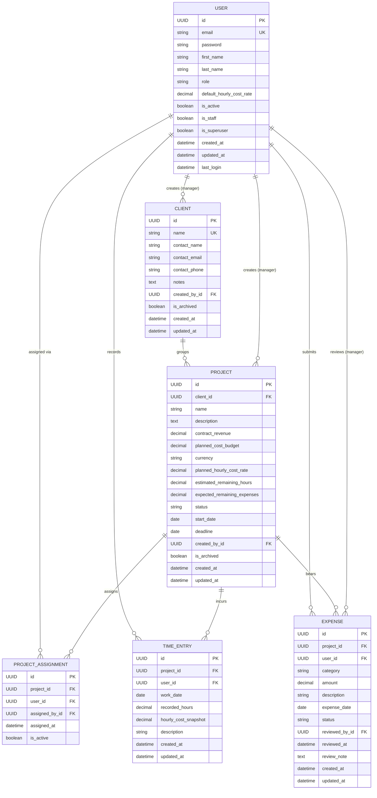

# MarginWatch — Conceptual Data Model & Entity Specifications

**Document Status:** Conceptual Domain Model (Phase 0)  
**Last Updated:** October 2026  
**Audience:** Data Architects, Backend Engineers, Database Administrators  
**Architecture Authority:** [ADR-001: Initial Architecture](decisions/ADR-001-initial-architecture.md) | [ADR-002: Single-Agency Architecture](decisions/ADR-002-single-agency-architecture.md)  
**Financial Rules Authority:** [docs/financial-rules.md](financial-rules.md) | [ADR-003: Financial Rules](decisions/ADR-003-financial-rules-and-risk-classification.md)  
**Backend Apps & Models Blueprint:** [docs/backend/backend-apps-and-data-models.md](backend/backend-apps-and-data-models.md)

---

## 1. Domain Modeling Philosophy & Architectural Boundaries

MarginWatch is engineered to deliver high financial integrity, transparent auditability, and unambiguous authorization boundaries for a **single software delivery agency**.

### 1.1 Single-Agency Architectural Constraint
- **Implicit Agency Scope:** MarginWatch serves exactly one agency per deployed application instance. The agency is represented implicitly by the system, not modeled as a database table.
- **No Multi-Tenant Boilerplate:** The database schema deliberately omits `Agency`, `Tenant`, and `AgencyMembership` models. All clients, projects, users, and financial records belong directly to the single operating agency.
- **Controlled Application Roles:** Users hold one of two application roles: `MANAGER` or `TEAM_MEMBER`. Django's `is_staff` and `is_superuser` flags serve strictly as administrative controls for the Django admin site and are never treated as substitutes for business application roles.

### 1.2 Core Modeling Principles
1. **Financial Immutability via Snapshots:** Internal labor costs evolve over time. To prevent retroactive distortion of past project costs, historical time entries permanently preserve an immutable snapshot of the logging member's internal hourly cost rate at the moment of entry (`hourly_cost_snapshot`). Changing a user's rate or a project's planned rate never alters historical records.
2. **Nullable Estimates (`null` $\ne$ `0.0`):** Estimating remaining scope in active development is uncertain. When a project's remaining effort is unestimated, `estimated_remaining_hours` is stored strictly as `null` (unknown). It is **never** silently stored as or converted to `0.0`, which would falsely represent a 100% complete delivery.
3. **Expense Review Lifecycle:** Expenses initiate in `PENDING` status and transition to `APPROVED` or `REJECTED` under manager authority, capturing reviewer ID, decision timestamp, and mandatory review notes.
4. **Exact Decimal Storage:** All monetary figures and hourly rates are modeled using fixed-precision decimals (`NUMERIC(12, 2)` for currency, `NUMERIC(10, 4)` for rates, `NUMERIC(6, 2)` for hours). Binary floating-point representation (`float`) is strictly prohibited.
5. **Cascading Deletion Defense:** Financial records must never be lost through accidental cascade deletion. Related entities (e.g., clients with projects, projects with time entries or expenses) enforce deletion protection (`PROTECT`/`RESTRICT`), utilizing soft archiving (`is_archived = True`) for lifecycle retirement.

---

## 2. Entity-Relationship Diagram (ERD)

---

## 3. Entity Specifications

---

### 3.1 `User`
Represents an agency staff member (either a `MANAGER` or `TEAM_MEMBER`).

* **Purpose:** Identity, authentication, role assignment, and tracking the base internal cost of employee labor.
* **Fields:**

| Field Name | Conceptual Type | Nullable | Default | Description & Constraints |
| :--- | :--- | :---: | :---: | :--- |
| `id` | UUID | No | Auto (`uuid4`) | Primary key. |
| `email` | String(254) | No | None | Unique login identifier; RFC 5322 normalized lowercase string. |
| `password` | String(255) | No | None | Securely hashed password managed by Django's PBKDF2/Argon2 authentication. |
| `first_name` | String(100) | No | None | User's given name. |
| `last_name` | String(100) | No | None | User's surname. |
| `role` | Enum / String(20) | No | `TEAM_MEMBER` | Controlled application role: `MANAGER` or `TEAM_MEMBER`. |
| `default_hourly_cost_rate` | Decimal(10, 4) | No | `0.0000` | Internal cost rate to the agency (wages + overhead). Constraint: $\ge 0.0000$. |
| `is_active` | Boolean | No | `True` | Account activity flag. If `False`, user is strictly prohibited from authenticating. |
| `is_staff` | Boolean | No | `False` | Django administrative flag for accessing Django admin portal. |
| `is_superuser` | Boolean | No | `False` | Django administrative flag granting all Django permissions. |
| `created_at` | DateTime | No | Auto (Now) | Record creation timestamp. |
| `updated_at` | DateTime | No | Auto (Now) | Record modification timestamp. |
| `last_login` | DateTime | Yes | Null | Timestamp of most recent successful authentication. |

* **Relationships:**
  - One-to-Many with `ProjectAssignment` (user assignments to projects).
  - One-to-Many with `TimeEntry` (labor entries logged by user).
  - One-to-Many with `Expense` as submitter (`user_id`).
  - One-to-Many with `Expense` as reviewer (`reviewed_by_id`).
  - One-to-Many with `Client` as creator (`created_by_id`).
  - One-to-Many with `Project` as creator (`created_by_id`).
* **Access & Ownership:**
  - Users can read and update their own basic profile (`first_name`, `last_name`).
  - `role` is a controlled field. A user **cannot elevate their own role** through profile updates or API payloads.
  - Only authorized users with `role == 'MANAGER'` can create users or modify user roles and `default_hourly_cost_rate`.
  - Team members can never view any other user's `default_hourly_cost_rate`.
* **Deletion Policy:** Soft deletion via `is_active = False`. Physical database deletion of users with historical time entries or expenses is prohibited (`PROTECT`).

---

### 3.2 `Client`
Represents a commercial client or customer account purchasing software delivery services.

* **Purpose:** Grouping projects under business accounts.
* **Fields:**

| Field Name | Conceptual Type | Nullable | Default | Description & Constraints |
| :--- | :--- | :---: | :---: | :--- |
| `id` | UUID | No | Auto (`uuid4`) | Primary key. |
| `name` | String(200) | No | None | Unique company or client name. |
| `contact_name` | String(150) | Yes | Null | Primary client contact person. |
| `contact_email` | String(254) | Yes | Null | Client contact email address. |
| `contact_phone` | String(50) | Yes | Null | Client contact phone number. |
| `notes` | Text | Yes | Null | Optional commercial or billing notes. |
| `created_by_id` | UUID (FK `User`) | Yes | Null | Manager who created the client record (`SET_NULL`). |
| `is_archived` | Boolean | No | `False` | Archive status flag. Filtered from active project selection. |
| `created_at` | DateTime | No | Auto (Now) | Creation timestamp. |
| `updated_at` | DateTime | No | Auto (Now) | Modification timestamp. |

* **Relationships:**
  - One-to-Many with `Project` (one client has multiple projects).
* **Access & Ownership:**
  - Managed exclusively by `MANAGER`.
  - Team members cannot create, update, or list clients directly; client names are exposed only as contextual metadata on projects assigned to the member.
* **Deletion Policy:** Protected against deletion (`on_delete=models.PROTECT`) if linked projects exist. Decommissioning is handled by setting `is_archived = True`.

---

### 3.3 `Project`
The core financial watchdog entity containing delivery budgets, contract revenues, and scope estimates.

* **Purpose:** Establishes the cost ceiling, revenue, currency, and forecast parameters for delivery monitoring.
* **Fields:**

| Field Name | Conceptual Type | Nullable | Default | Description & Constraints |
| :--- | :--- | :---: | :---: | :--- |
| `id` | UUID | No | Auto (`uuid4`) | Primary key. |
| `client_id` | UUID (FK `Client`) | No | None | References `Client.id`. Must reference a valid, non-deleted client (`PROTECT`). |
| `name` | String(200) | No | None | Name of the project. |
| `description` | Text | Yes | Null | Optional delivery scope description. |
| `contract_revenue` | Decimal(12, 2) | No | `0.00` | Agreed client contract price ($R \ge 0.00$). |
| `planned_cost_budget` | Decimal(12, 2) | No | None | Internal delivery-cost ceiling ($B > 0.00$). |
| `planned_hourly_cost_rate` | Decimal(10, 4) | No | None | Blended hourly cost used for remaining estimates ($C_{hourly\_plan} > 0.00$). |
| `currency` | String(3) | No | `USD` | ISO 4217 3-letter currency code (e.g., `USD`, `EUR`, `GBP`). |
| `estimated_remaining_hours`| Decimal(8, 2) | **Yes** | **Null** | **Critical:** `null` = estimate unknown; `0.0` = scope complete. Constraint: $\ge 0.00$ when not null. |
| `expected_remaining_expenses`| Decimal(12, 2)| No | `0.00` | Un-incurred future direct expenses ($E_{rem} \ge 0.00$). Defaults to `0.00`. |
| `status` | Enum / String(20) | No | `ACTIVE` | Choices: `PLANNING`, `ACTIVE`, `COMPLETED`, `ON_HOLD`, `ARCHIVED`. |
| `start_date` | Date | Yes | Null | Scheduled project kickoff date. |
| `deadline` | Date | Yes | Null | Target project delivery deadline. Constraint: `deadline >= start_date` if both set. |
| `created_by_id` | UUID (FK `User`) | Yes | Null | User who created the project record (`SET_NULL`). |
| `is_archived` | Boolean | No | `False` | Soft-archiving flag. Excluded from default active dashboards. |
| `created_at` | DateTime | No | Auto (Now) | Creation timestamp. |
| `updated_at` | DateTime | No | Auto (Now) | Modification timestamp. |

* **Relationships:**
  - Belongs to one `Client`.
  - One-to-Many with `ProjectAssignment` (assigned team members).
  - One-to-Many with `TimeEntry` (labor entries).
  - One-to-Many with `Expense` (direct expenses).
* **Access & Ownership:**
  - Financial baselines (`contract_revenue`, `planned_cost_budget`, `planned_hourly_cost_rate`, margins) are visible and editable strictly by `MANAGER`.
  - Assigned `TEAM_MEMBER` users see basic project metadata (`name`, `description`, `status`), but all financial metrics and budgets are masked by backend serializers.
* **Deletion Policy:** Deletion is strictly prohibited (`PROTECT`) if linked time entries or expenses exist. Projects are archived via `status = 'ARCHIVED'` or `is_archived = True`.
* **Indexes:** Index on `client_id`, `status`, `is_archived`.

---

### 3.4 `ProjectAssignment`
Explicit assignment table linking eligible team members to projects.

* **Purpose:** Authoritative object-level access control boundary. Team members can only view projects, log time, and submit expenses for projects where an active assignment exists.
* **Fields:**

| Field Name | Conceptual Type | Nullable | Default | Description & Constraints |
| :--- | :--- | :---: | :---: | :--- |
| `id` | UUID | No | Auto (`uuid4`) | Primary key. |
| `project_id` | UUID (FK `Project`) | No | None | References `Project.id` (`CASCADE`). |
| `user_id` | UUID (FK `User`) | No | None | References `User.id` (`CASCADE`). User must be an active user. |
| `assigned_by_id` | UUID (FK `User`) | Yes | Null | References `User.id` (manager who created the assignment, `SET_NULL`). |
| `assigned_at` | DateTime | No | Auto (Now) | Assignment creation timestamp. |
| `is_active` | Boolean | No | `True` | Active status of the assignment. If `False`, access is revoked without destroying history. |

* **Constraints:**
  - Unique composite constraint: `unique_together = ('project_id', 'user_id')`. Duplicate assignments are strictly prohibited.
* **Access & Ownership:**
  - Only `MANAGER` can create, activate, or revoke assignments.
  - Team members can query their own assignments to determine authorized projects.
* **Indexes:** Composite index on `(user_id, is_active)` and `(project_id, is_active)` for rapid authorization checks.

---

### 3.5 `TimeEntry`
Records individual labor durations logged against an authorized project.

* **Purpose:** Primary driver of actual internal labor cost ($C_{labor}$).
* **Fields:**

| Field Name | Conceptual Type | Nullable | Default | Description & Constraints |
| :--- | :--- | :---: | :---: | :--- |
| `id` | UUID | No | Auto (`uuid4`) | Primary key. |
| `project_id` | UUID (FK `Project`) | No | None | References `Project.id` (`PROTECT`). |
| `user_id` | UUID (FK `User`) | No | None | References `User.id` (`PROTECT`). Author of the entry. |
| `work_date` | Date | No | None | Calendar date work occurred. Cannot be more than 1 day in the future. |
| `recorded_hours` | Decimal(5, 2) | No | None | Labor duration. Constraint: $0.00 < \text{recorded\_hours} \le 24.00$. |
| `hourly_cost_snapshot`| Decimal(10, 4) | No | None | Internal cost rate captured at creation from `User.default_hourly_cost_rate`. **Permanently immutable.** Constraint: $\ge 0.0000$. |
| `description` | String(500) | No | None | Non-empty summary of work completed. |
| `created_at` | DateTime | No | Auto (Now) | Creation timestamp. |
| `updated_at` | DateTime | No | Auto (Now) | Modification timestamp. |

* **Constraints:**
  - Check constraint: `recorded_hours > 0.00 AND recorded_hours <= 24.00`.
  - Immutability: Once created, `hourly_cost_snapshot` cannot be updated under any circumstances.
* **Access & Ownership:**
  - Team members can log time only to projects with an active `ProjectAssignment`.
  - Team members can view, edit, or delete strictly their own time entries.
  - `hourly_cost_snapshot` is omitted from team member serializers.
  - Managers can view all time entries across all projects.
* **Indexes:** Composite index on `(project_id, work_date)` and `(user_id, work_date)`.

---

### 3.6 `Expense`
Records direct project expenditures (subcontractors, software licenses, travel, materials).

* **Purpose:** Direct non-labor project expenditures governed by an explicit review workflow.
* **Fields:**

| Field Name | Conceptual Type | Nullable | Default | Description & Constraints |
| :--- | :--- | :---: | :---: | :--- |
| `id` | UUID | No | Auto (`uuid4`) | Primary key. |
| `project_id` | UUID (FK `Project`) | No | None | References `Project.id` (`PROTECT`). |
| `user_id` | UUID (FK `User`) | No | None | Submitting team member or manager (`PROTECT`). |
| `category` | Enum / String(30) | No | None | Choices: `SUBCONTRACTOR`, `SOFTWARE_LICENSE`, `HARDWARE`, `TRAVEL`, `OTHER`. |
| `amount` | Decimal(12, 2) | No | None | Expenditure amount. Constraint: $> 0.00$. |
| `description` | String(500) | No | None | Purpose and context of expenditure. |
| `expense_date` | Date | No | None | Date expenditure was incurred. |
| `status` | Enum / String(20) | No | `PENDING` | Choices: `PENDING`, `APPROVED`, `REJECTED`. |
| `reviewed_by_id` | UUID (FK `User`) | Yes | Null | References `User.id` (manager who reviewed the expense, `SET_NULL`). |
| `reviewed_at` | DateTime | Yes | Null | Timestamp of approval or rejection. |
| `review_note` | Text | Yes | Null | Explanation note. Mandatory if `status = REJECTED`. |
| `created_at` | DateTime | No | Auto (Now) | Creation timestamp. |
| `updated_at` | DateTime | No | Auto (Now) | Modification timestamp. |

* **Constraints:**
  - Check constraint: `amount > 0.00`.
  - Conditional validation: if `status == 'REJECTED'`, `review_note` must be non-empty.
  - Financial immutability: once `status` is `APPROVED` or `REJECTED`, the `amount`, `category`, and `project_id` become permanently read-only.
* **Access & Ownership:**
  - Team members can submit expenses against assigned projects and inspect their own submissions.
  - Only `MANAGER` can transition status to `APPROVED` or `REJECTED`.
  - Only `APPROVED` expenses enter the project's actual cost calculations ($C_{expense}$).
* **Indexes:** Composite index on `(project_id, status)` for fast aggregation of approved expenses.

---

## 4. Integrity Constraints & Cross-Model Business Rules

| Rule ID | Category | Enforcement Level | Rule Definition & Specification |
| :--- | :--- | :---: | :--- |
| **BR-INT-01** | Non-Negative Monetary Values | Database & Serializer | `contract_revenue >= 0.00`, `planned_cost_budget > 0.00`, `planned_hourly_cost_rate > 0.00`, `default_hourly_cost_rate >= 0.00`, `amount > 0.00`. |
| **BR-INT-02** | Positive Hours | Database & Serializer | `recorded_hours > 0.00` and `recorded_hours <= 24.00`. |
| **BR-INT-03** | Missing Estimates Semantics | Application & Storage | `estimated_remaining_hours` may be `NULL` (unknown) or `0.00` (complete). Database column must be nullable. Application must never coerce `NULL` to `0.00`. |
| **BR-INT-04** | Assignment Uniqueness | Database (Unique Index) | Composite unique constraint on `(project_id, user_id)`. Prevents duplicate assignments of the same user to a project. |
| **BR-INT-05** | Eligible Assignment User | Application Service | User assigned to a project must be an existing, active user (`is_active = True`). |
| **BR-INT-06** | Rate Snapshot Immutability | Model & Serializer | `TimeEntry.hourly_cost_snapshot` is populated automatically from `User.default_hourly_cost_rate` at creation and is thereafter read-only. Updating user default rates or project planned rates has zero retroactive effect on existing time entries. |
| **BR-INT-07** | Cascade Deletion Protection | Database (`PROTECT`) | Clients cannot be deleted if projects exist. Projects cannot be deleted if time entries or expenses exist. Users cannot be deleted if time entries or expenses exist. Decommissioning is performed via archiving (`is_archived = True`). |
| **BR-INT-08** | Archived Record Filtering | Queryset Managers | Active API querysets automatically filter out `is_archived = True` records unless an explicit `?include_archived=true` query parameter is supplied by an authorized Manager. |
| **BR-INT-09** | Rejection Reason Mandatory | Serializer / Service | Transitioning an Expense to `REJECTED` strictly requires a non-empty `review_note`. |
| **BR-INT-10** | Assignment Required for Work | Permission Engine | Non-manager users cannot log time or submit expenses to projects unless an active `ProjectAssignment` (`is_active = True`) exists for `(project_id, request.user.id)`. |

---

## 5. Architectural Alignment & Model Count Summary

The single-agency application contains **exactly six core domain models**:

1. `User` (Authentication, application roles `MANAGER` / `TEAM_MEMBER`, base cost rate).
2. `Client` (Commercial customer accounts).
3. `Project` (Budgets, revenues, rates, scope estimates, status).
4. `ProjectAssignment` (Explicit user-to-project access control join table).
5. `TimeEntry` (Labor tracking with immutable rate snapshots).
6. `Expense` (Direct project expenditures with two-stage manager review lifecycle).

Multi-tenancy models (`Agency`, `Tenant`, `AgencyMembership`) are completely absent from this schema, fulfilling the single-agency architecture mandate.
