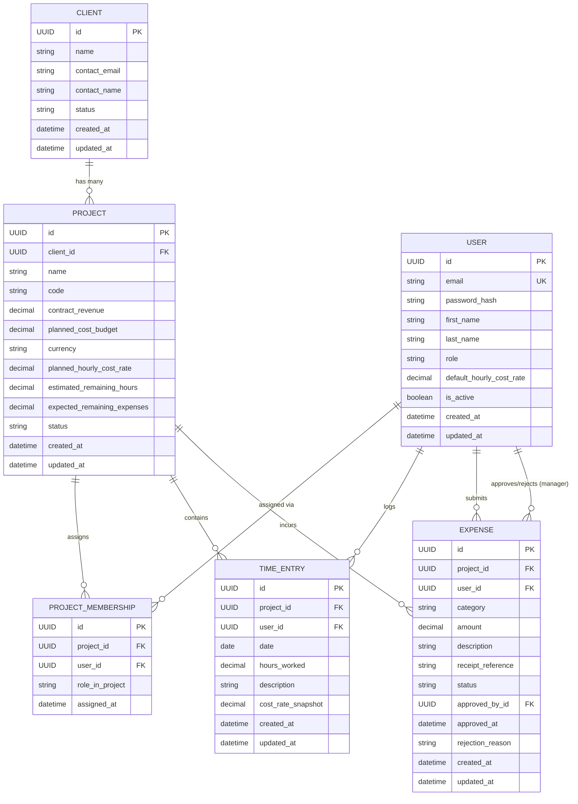

# MarginWatch — Conceptual Data Model & Entity Specifications

**Document Status:** Conceptual Domain Model (Phase 0)  
**Last Updated:** October 2026  
**Audience:** Data Architects, Backend Engineers, Database Administrators  
**Financial Rules Authority:** [docs/financial-rules.md](financial-rules.md) | [ADR-002](decisions/ADR-002-financial-rules-and-risk-classification.md)

---

## 1. Domain Modeling Philosophy

The MarginWatch data model is designed to support high financial integrity, transparent auditability, and clear access boundaries for small- to mid-sized software agencies.

### Core Modeling Principles
1. **Financial Immutability via Snapshots:** Hourly labor costs change over time. To prevent retroactive distortion of past project costs, historical time entries snapshot the active internal cost rate at the moment of creation (`cost_rate_snapshot`).
2. **Nullable Estimates (`null` $\ne$ `0.0`):** Estimating remaining scope in active development is uncertain. When a project's remaining hours have not been estimated, `estimated_remaining_hours` is stored as `null` (unknown). It is **never** silently stored as or converted to zero (`0.0`), which would falsely indicate that the project is 100% delivered.
3. **Expense Audit Lifecycle:** Expenses initiate in `PENDING` and transition to `APPROVED` or `REJECTED` under manager authority, capturing reviewer ID, decision timestamp, and mandatory rejection reasons.
4. **Clean Decimal Storage:** All monetary values and hourly rates are modeled conceptually as fixed-precision decimals (`NUMERIC(12, 2)` for currency, `NUMERIC(10, 4)` for rates), never binary floating-point numbers.
5. **Strict Currency Boundaries:** Every project defines a single ISO 4217 currency (`currency`). All child time entries and expenses operate under this currency baseline; cross-currency conversions are disallowed in the MVP.

---

## 2. Entity-Relationship Diagram (ERD)

---

## 3. Entity Specifications

---

### 3.1 `User`
Represents an agency staff member (either an Agency Manager or a Team Member).

* **Purpose:** Identity, authentication, role assignment, and establishing the base internal cost of employee labor.
* **Proposed Fields:**

| Field Name | Conceptual Type | MVP Status | Required | Default | Description & Constraints |
| :--- | :--- | :---: | :---: | :---: | :--- |
| `id` | UUID / Int | MVP | Yes | Auto | Unique identifier. |
| `email` | String(254) | MVP | Yes | None | Unique login identifier; RFC 5322 compliant. |
| `password_hash` | String(255) | MVP | Yes | None | Securely hashed credential (Argon2 / PBKDF2). |
| `first_name` | String(100) | MVP | Yes | None | User's given name. |
| `last_name` | String(100) | MVP | Yes | None | User's family name. |
| `role` | Enum / String(20) | MVP | Yes | `TEAM_MEMBER` | Options: `AGENCY_MANAGER`, `TEAM_MEMBER`. |
| `default_hourly_cost_rate` | Decimal(10, 4) | MVP | Yes | `0.0000` | The user's internal hourly cost to the agency (wages + overhead). $\ge 0.00$. |
| `is_active` | Boolean | MVP | Yes | `True` | Controls login ability without destroying relational history. |
| `created_at` | DateTime | MVP | Yes | Current Time | Record creation timestamp. |
| `updated_at` | DateTime | MVP | Yes | Current Time | Record modification timestamp. |

* **Relationships:**
  - One-to-Many with `ProjectMembership` (user can be assigned to many projects).
  - One-to-Many with `TimeEntry` (user logs their own time entries).
  - One-to-Many with `Expense` as author (`user_id`).
  - One-to-Many with `Expense` as reviewer (`approved_by_id`).
* **Access & Ownership:**
  - Users can read and update their own basic profile.
  - Only `AGENCY_MANAGER` can modify `role` and `default_hourly_cost_rate`.
  - Team members cannot view other users' `default_hourly_cost_rate`.
* **Deletion Policy:** Soft deletion via `is_active = False` to preserve historical audit records.

---

### 3.2 `Client`
Represents a customer or commercial account purchasing software delivery services.

* **Purpose:** Grouping projects under contractual accounts.
* **Proposed Fields:**

| Field Name | Conceptual Type | MVP Status | Required | Default | Description & Constraints |
| :--- | :--- | :---: | :---: | :---: | :--- |
| `id` | UUID / Int | MVP | Yes | Auto | Unique identifier. |
| `name` | String(200) | MVP | Yes | None | Company or client name (Unique within agency). |
| `contact_email` | String(254) | MVP | No | Null | Client primary contact email. |
| `contact_name` | String(150) | MVP | No | Null | Client representative name. |
| `status` | Enum / String(20) | MVP | Yes | `ACTIVE` | Options: `ACTIVE`, `ARCHIVED`. |
| `created_at` | DateTime | MVP | Yes | Current Time | Creation timestamp. |
| `updated_at` | DateTime | MVP | Yes | Current Time | Modification timestamp. |

* **Relationships:**
  - One-to-Many with `Project` (one client has multiple projects).
* **Access & Ownership:**
  - Managed exclusively by `AGENCY_MANAGER`.
  - Team members can view client names only when assigned to projects under that client.
* **Deletion Policy:** `RESTRICT` on delete if associated projects exist.

---

### 3.3 `Project`
The core watchdog entity containing financial baselines, scope estimates, and budget limits.

* **Purpose:** Establishes the cost ceiling, contract price, currency, and forecast parameters for delivery monitoring.
* **Proposed Fields:**

| Field Name | Conceptual Type | MVP Status | Required | Default | Description & Constraints |
| :--- | :--- | :---: | :---: | :---: | :--- |
| `id` | UUID / Int | MVP | Yes | Auto | Unique identifier. |
| `client_id` | UUID / Int (FK) | MVP | Yes | None | References `Client.id`. |
| `name` | String(200) | MVP | Yes | None | Name of the project. |
| `code` | String(20) | MVP | Yes | None | Unique human-readable code (e.g., `PRJ-ALPHA`). |
| `contract_revenue` | Decimal(12, 2) | MVP | Yes | `0.00` | Agreed client contract value ($R \ge 0.00$). |
| `planned_cost_budget` | Decimal(12, 2) | MVP | Yes | None | Internal delivery-cost ceiling ($B > 0.00$). |
| `currency` | String(3) | MVP | Yes | `USD` | ISO 4217 3-letter currency code (e.g., `USD`, `EUR`). |
| `planned_hourly_cost_rate` | Decimal(10, 4) | MVP | Yes | None | Blended hourly cost used for remaining estimates ($C_{hourly\_plan} > 0.00$). |
| `estimated_remaining_hours`| Decimal(8, 2) | MVP | **No (Nullable)**| **Null** | **Critical:** `null` = estimate unknown; `0.0` = scope explicitly complete. Must NEVER be stored as zero when missing! |
| `expected_remaining_expenses`| Decimal(12, 2)| MVP (Default) | Yes | `0.00` | Known future direct expenses ($E_{rem} \ge 0.00$). In MVP defaults to `0.00`. |
| `status` | Enum / String(20) | MVP | Yes | `ACTIVE` | Options: `PLANNING`, `ACTIVE`, `COMPLETED`, `ON_HOLD`. |
| `created_at` | DateTime | MVP | Yes | Current Time | Creation timestamp. |
| `updated_at` | DateTime | MVP | Yes | Current Time | Modification timestamp. |

* **Relationships:**
  - Belongs to one `Client`.
  - Many-to-Many with `User` via `ProjectMembership`.
  - One-to-Many with `TimeEntry`.
  - One-to-Many with `Expense`.
* **Access & Ownership:**
  - Financial baselines (`contract_revenue`, `planned_cost_budget`, `planned_hourly_cost_rate`) visible and editable only by `AGENCY_MANAGER`.
  - Team members see project name and code, but not budgets, revenues, or margins.
* **Indexes:** Unique index on `code`; index on `client_id`, `status`.

---

### 3.4 `ProjectMembership`
Explicit assignment join table linking Team Members to authorized Projects.

* **Purpose:** Enforce object-level authorization (preventing team members from logging time or expenses to projects they are not assigned to).
* **Proposed Fields:**

| Field Name | Conceptual Type | MVP Status | Required | Default | Description & Constraints |
| :--- | :--- | :---: | :---: | :---: | :--- |
| `id` | UUID / Int | MVP | Yes | Auto | Unique identifier. |
| `project_id` | UUID / Int (FK) | MVP | Yes | None | References `Project.id`. |
| `user_id` | UUID / Int (FK) | MVP | Yes | None | References `User.id`. |
| `role_in_project` | String(50) | MVP | No | `Contributor`| Optional designation (e.g., `Lead Developer`, `UI Designer`). |
| `assigned_at` | DateTime | MVP | Yes | Current Time | Assignment timestamp. |

* **Constraints:** Unique composite constraint on `(project_id, user_id)`.

---

### 3.5 `TimeEntry`
Records individual labor durations logged against an authorized project.

* **Purpose:** Primary driver of actual labor costs ($C_{labor}$).
* **Proposed Fields:**

| Field Name | Conceptual Type | MVP Status | Required | Default | Description & Constraints |
| :--- | :--- | :---: | :---: | :---: | :--- |
| `id` | UUID / Int | MVP | Yes | Auto | Unique identifier. |
| `project_id` | UUID / Int (FK) | MVP | Yes | None | References `Project.id`. |
| `user_id` | UUID / Int (FK) | MVP | Yes | None | References `User.id` (author). |
| `date` | Date | MVP | Yes | None | Calendar date work occurred. |
| `hours_worked` | Decimal(5, 2) | MVP | Yes | None | Labor duration ($0.00 < \text{hours} \le 24.00$). |
| `description` | String(500) | MVP | Yes | None | Summary of work completed. |
| `cost_rate_snapshot` | Decimal(10, 4) | MVP | Yes | None | Snapshot of author's `default_hourly_cost_rate` at moment of entry. Immutable. |
| `created_at` | DateTime | MVP | Yes | Current Time | Creation timestamp. |
| `updated_at` | DateTime | MVP | Yes | Current Time | Modification timestamp. |

* **Constraints:** Check constraint `hours_worked > 0.0 AND hours_worked <= 24.0`.
* **Access & Ownership:**
  - Team member can edit or delete their own unbilled time entries.
  - Team member cannot view or alter `cost_rate_snapshot`.
  - Agency Managers can view all time entries across all projects.
* **Indexes:** Composite index on `(project_id, date)` and `(user_id, date)` for rapid aggregation.

---

### 3.6 `Expense`
Records direct project expenditures (subcontractors, software licenses, travel).

* **Purpose:** Captures direct project costs with an explicit managerial review lifecycle.
* **Proposed Fields:**

| Field Name | Conceptual Type | MVP Status | Required | Default | Description & Constraints |
| :--- | :--- | :---: | :---: | :---: | :--- |
| `id` | UUID / Int | MVP | Yes | Auto | Unique identifier. |
| `project_id` | UUID / Int (FK) | MVP | Yes | None | References `Project.id`. |
| `user_id` | UUID / Int (FK) | MVP | Yes | None | References `User.id` (submitting user). |
| `category` | Enum / String(30) | MVP | Yes | None | Options: `SUBCONTRACTOR`, `SOFTWARE_LICENSE`, `HARDWARE`, `TRAVEL`, `OTHER`. |
| `amount` | Decimal(12, 2) | MVP | Yes | None | Expenditure amount ($> 0.00$). |
| `description` | String(500) | MVP | Yes | None | Detailed purpose of expenditure. |
| `receipt_reference` | String(255) | MVP | No | Null | Receipt URL or document identifier. |
| `status` | Enum / String(20) | MVP | Yes | `PENDING` | Options: `PENDING`, `APPROVED`, `REJECTED`. |
| `approved_by_id` | UUID / Int (FK) | MVP | No | Null | References `User.id` (manager who approved/rejected). |
| `approved_at` | DateTime | MVP | No | Null | Timestamp of approval/rejection decision. |
| `rejection_reason` | String(500) | MVP | No | Null | Mandatory explanation if `status = REJECTED`. |
| `created_at` | DateTime | MVP | Yes | Current Time | Creation timestamp. |
| `updated_at` | DateTime | MVP | Yes | Current Time | Modification timestamp. |

* **Constraints:**
  - Check constraint `amount > 0.00`.
  - Conditional validation: if `status = REJECTED`, `rejection_reason` must not be null/empty.
  - Immutability constraint: once `status` is `APPROVED` or `REJECTED`, `amount`, `category`, and `project_id` cannot be altered.
* **Access & Ownership:**
  - Team members can submit expenses for assigned projects and view their own submissions.
  - Only `AGENCY_MANAGER` can transition status to `APPROVED` or `REJECTED`.
* **Indexes:** Composite index on `(project_id, status)` for fast filtering of approved expenses.

---

## 4. MVP vs. Future Model Expansions

| Capability | MVP (Phase 2) | Future Milestone (v1.1+) |
| :--- | :--- | :--- |
| **Remaining Hours Estimate** | Nullable decimal field on `Project` (`null` = unknown). | Historical estimate tracking table logging estimation revisions over time. |
| **Expected Remaining Expenses** | Scalar decimal defaulting to `$0.00` on `Project`. | Explicit `ExpenseForecast` milestone schedule with auto-deduction. |
| **Multi-Tenancy** | Single agency deployment per database instance. | Explicit `Organization` entity with multi-tenant schema isolation. |
| **Receipt Storage** | String reference / URL. | S3 / Cloud Storage direct file uploads with MIME-type verification. |
| **Rate Card Complexity** | One `default_hourly_cost_rate` per user. | Role-based rate cards, project-specific member rates, overtime multipliers. |
| **Audit Log** | Timestamp and user foreign keys on entities. | Dedicated `AuditLog` table recording JSON diffs of every model mutation. |
| **Tags / Milestones** | Flat project scope. | `Milestone` entity breaking project budget into sub-deliverables. |
