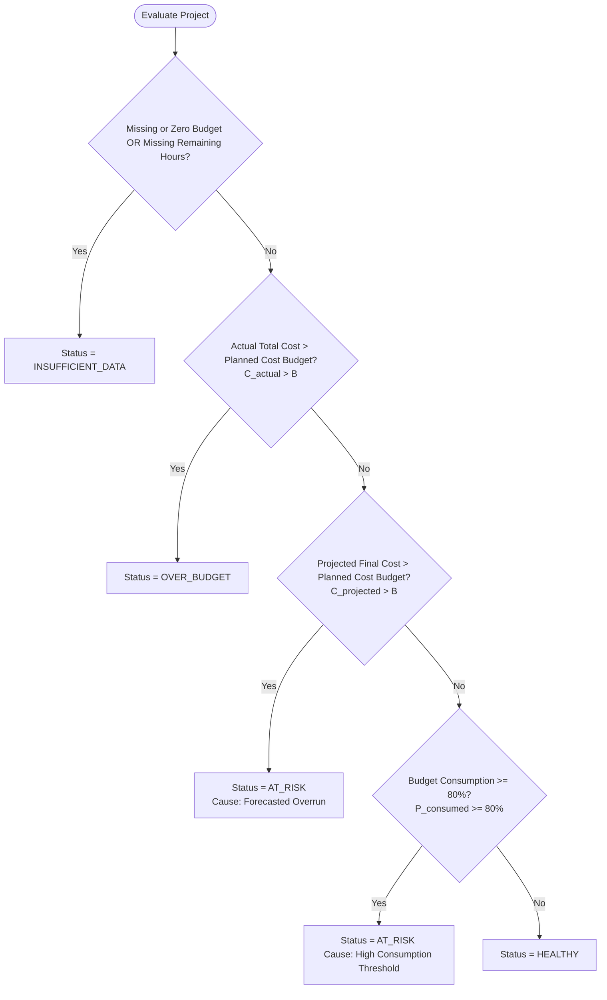

# MarginWatch — Financial Rules and Calculation Specifications

**Document Status:** Authoritative Source of Truth (Phase 0)  
**Last Updated:** October 2026  
**Audience:** Backend Engineers, Financial Domain Experts, Quality Assurance  

---

## 1. Overview & Core Philosophy

MarginWatch provides small software agencies with transparent, deterministic financial monitoring. Financial calculations must be:
1. **Deterministic:** Given the same underlying time entries, approved expenses, and project baselines, the engine must produce the exact same figures down to the penny.
2. **Defensive:** Prevent mathematical hazards (such as division by zero or floating-point rounding errors) and explicitly surface data inadequacies rather than guessing.
3. **Audit-Proof:** Every historical time entry preserves the cost rate active when the work occurred, ensuring historical financials are never distorted by future organizational changes.

---

## 2. Core Financial Concepts & Definitions

| Term | Symbol | Conceptual Definition | Persistence & Mutability |
| :--- | :---: | :--- | :--- |
| **Contract Revenue** | $R$ | The total monetary amount the client has agreed to pay the agency for the agreed scope of work (fixed-price contract or fixed budget cap). | Stored on `Project`. Configurable only by Agency Managers. |
| **Planned Cost Budget** | $B$ | The internal delivery-cost limit allocated to complete the project (direct labor cost + direct expenses). Represents the agency's planned expenditure ceiling. | Stored on `Project`. Configurable only by Agency Managers. |
| **Estimated Remaining Hours** | $H_{rem}$ | The estimated number of labor hours required to finish all outstanding project deliverables. | Stored on `Project`. Updated as scope is delivered or discovered. |
| **Planned Internal Hourly Cost** | $C_{hourly\_plan}$ | The blended or anticipated internal cost-per-hour used to value remaining estimated labor. | Stored on `Project`. Defaults to agency or project default rate. |
| **Historical Hourly Cost Snapshot** | $C_{entry}$ | The internal cost rate of the team member at the moment the time entry was recorded. | Stored on `TimeEntry`. **Immutable once created.** |
| **Recorded Hours** | $H_{entry}$ | The duration of labor logged in a single time entry. | Stored on `TimeEntry`. |
| **Approved Expenses** | $E_{appr}$ | Direct third-party project expenditures (subcontractors, software licenses, travel) officially approved by an Agency Manager. | Derived from `Expense` where `status = APPROVED`. |
| **Expected Remaining Expenses** | $E_{rem}$ | Known or anticipated future project expenditures not yet incurred or approved. | Stored on `Project`. Configurable by Agency Managers. |
| **Actual Labor Cost** | $C_{labor}$ | The cumulative monetary cost of all internal labor logged to date against the project. | Calculated dynamically. |
| **Actual Total Cost** | $C_{actual}$ | The sum of actual labor costs and approved direct expenses incurred to date. | Calculated dynamically. |
| **Budget Consumption %** | $P_{consumed}$ | The proportion of the internal planned cost budget that has already been spent. | Calculated dynamically. |
| **Estimated Remaining Labor Cost** | $C_{rem\_labor}$ | The monetary forecast of remaining labor required to complete the project. | Calculated dynamically. |
| **Projected Final Cost** | $C_{projected}$ | The total expected cost at project completion (actual costs spent to date + forecast to complete). | Calculated dynamically. |
| **Projected Profit** | $P_{profit}$ | The forecasted net monetary return to the agency upon project delivery. | Calculated dynamically. |
| **Projected Profit Margin %** | $M_{profit}$ | The forecasted profitability expressed as a percentage of contract revenue. | Calculated dynamically. |
| **Deterministic Risk Status** | $S_{risk}$ | The discrete health classification of the project (`HEALTHY`, `AT_RISK`, `OVER_BUDGET`, `INSUFFICIENT_DATA`). | Evaluated deterministically via rule hierarchy. |

---

## 3. Authoritative Mathematical Formulas

### 3.1 Actual Labor Cost ($C_{labor}$)
The sum of recorded hours multiplied by each entry's historical cost rate snapshot:
$$C_{labor} = \sum_{i=1}^{N} \left( H_{entry, i} \times C_{entry, i} \right)$$
*Rule:* Only entries associated with the project are included. If $N = 0$, $C_{labor} = 0.00$.

### 3.2 Actual Total Cost ($C_{actual}$)
$$C_{actual} = C_{labor} + \sum E_{appr}$$
*Rule:* Only expenses with status `APPROVED` are included. `PENDING` and `REJECTED` expenses are strictly excluded.

### 3.3 Budget Consumption Percentage ($P_{consumed}$)
$$P_{consumed} = \begin{cases} 
\left( \frac{C_{actual}}{B} \right) \times 100, & \text{if } B > 0 \\
\text{undefined (null)}, & \text{if } B \le 0 \text{ or } B \text{ is null}
\end{cases}$$

### 3.4 Estimated Remaining Labor Cost ($C_{rem\_labor}$)
$$C_{rem\_labor} = \begin{cases}
H_{rem} \times C_{hourly\_plan}, & \text{if } H_{rem} \ge 0 \text{ and } C_{hourly\_plan} \ge 0 \\
\text{undefined (null)}, & \text{if } H_{rem} \text{ is null}
\end{cases}$$

### 3.5 Projected Final Cost ($C_{projected}$)
$$C_{projected} = \begin{cases}
C_{actual} + C_{rem\_labor} + E_{rem}, & \text{if } C_{rem\_labor} \text{ is defined} \\
\text{undefined (null)}, & \text{if } C_{rem\_labor} \text{ is null}
\end{cases}$$
*(Note: If $E_{rem}$ is null or omitted, it defaults to $0.00$.)*

### 3.6 Projected Profit ($P_{profit}$)
$$P_{profit} = \begin{cases}
R - C_{projected}, & \text{if } R \ge 0 \text{ and } C_{projected} \text{ is defined} \\
\text{undefined (null)}, & \text{if } C_{projected} \text{ is null}
\end{cases}$$

### 3.7 Projected Profit Margin Percentage ($M_{profit}$)
$$M_{profit} = \begin{cases}
\left( \frac{P_{profit}}{R} \right) \times 100, & \text{if } R > 0 \text{ and } P_{profit} \text{ is defined} \\
\text{undefined (null)}, & \text{if } R \le 0 \text{ or } P_{profit} \text{ is null}
\end{cases}$$

---

## 4. Fundamental Financial Rules & Constraints

### 4.1 Decimal-Safe Arithmetic
- Binary floating-point types (`float` in Python or JavaScript) are strictly prohibited for financial calculations due to representation inaccuracies (e.g., $0.1 + 0.2 \ne 0.3$).
- The backend must perform all intermediate calculations using exact decimal arithmetic (`decimal.Decimal` in Python, backed by `NUMERIC(12, 4)` in the database).
- Display values and API response totals are rounded half-up (`ROUND_HALF_UP`) to two decimal places (`0.01`).
- Percentages are rounded half-up to two decimal places (`0.01%`).

### 4.2 Single-Currency Boundary
- For the MVP, each project is bound to a single configured currency (e.g., `USD`, `EUR`, `GBP`).
- All rates, time entry cost snapshots, expenses, budgets, and revenues within that project must share this currency.
- Cross-currency arithmetic or silent conversion is strictly prohibited. Multi-currency support is deferred to post-MVP roadmap milestones.

### 4.3 Division by Zero Prevention
- If Planned Cost Budget ($B \le 0$ or null), $P_{consumed}$ evaluates to `null`.
- If Contract Revenue ($R \le 0$ or null), $M_{profit}$ evaluates to `null`.
- The calculation service must never throw an unhandled `ZeroDivisionError` or produce `NaN` / `Infinity`.

### 4.4 Non-Negative Financial Validation
- The system shall reject input payloads with:
  - Hours worked: $H_{entry} \le 0$ or $H_{entry} > 24.0$ per entry.
  - Expense amount: $E \le 0$.
  - Contract revenue: $R < 0$.
  - Planned cost budget: $B \le 0$.
  - Estimated remaining hours: $H_{rem} < 0$.
  - Planned hourly rate: $C_{hourly} < 0$.

### 4.5 Expense State Segregation
- **`PENDING` Expenses:** Logged but awaiting review. Excluded from actual total costs. Incurred totals of pending expenses are surfaced in dashboard summaries for situational awareness, but do not burn budget.
- **`APPROVED` Expenses:** Confirmed project expenditures. Instantly incorporated into $C_{actual}$.
- **`REJECTED` Expenses:** Disallowed expenditures. Permanently excluded from all financial calculations.

### 4.6 Historical Hourly-Rate Snapshot Integrity
- When a user logs hours, their current personal hourly cost rate is copied to `TimeEntry.cost_rate_snapshot`.
- If an employee receives a salary raise or their internal billing cost is updated next month, existing historical time entries retain their original snapshot.
- Recalculating past projects must produce authentic historical costs, not retroactive distortions.

### 4.7 Budget Consumption vs. Project Completion
- **Critical Principle:** Budget consumption ($P_{consumed}$) measures money spent, **not** work delivered.
- An agency that has consumed 80% of its budget has not necessarily completed 80% of the project. If the scope is only 40% delivered, the project is severely at risk.
- MarginWatch explicitly separates actual cost accumulation ($C_{actual}$) from scope-to-complete forecasting ($C_{projected}$).

---

## 5. Deterministic Risk Status Determination

Projects are evaluated against four distinct statuses. Because multiple conditions may be true simultaneously (e.g., both high consumption and forecasted overrun), evaluation occurs in a **strict precedence hierarchy**.

### 5.1 Status Definitions

| Status | Code | Semantic Meaning |
| :--- | :--- | :--- |
| **Insufficient Data** | `INSUFFICIENT_DATA` | Essential forecasting baselines are missing ($B$ is missing/zero, or $H_{rem}$ is null). Reliable forecasting is impossible. |
| **Over Budget** | `OVER_BUDGET` | Actual money spent to date already exceeds the total planned cost budget ($C_{actual} > B$). The overrun is an established fact. |
| **At Risk** | `AT_RISK` | The project has not yet breached its budget in actual spending, but early warning indicators show imminent overrun: projected final cost exceeds budget ($C_{projected} > B$), OR actual budget consumption has reached or exceeded the 80% warning threshold ($P_{consumed} \ge 80\%$). |
| **Healthy** | `HEALTHY` | Actual spending is within safe limits ($P_{consumed} < 80\%$) and the projected final cost is less than or equal to the planned budget ($C_{projected} \le B$). |

### 5.2 Precedence Hierarchy

The evaluation algorithm executes the following rules in order; the **first** matched condition determines the project status:

### 5.3 Rationale for the 80% Heuristic
The 80% consumption threshold is a battle-tested agency warning trigger. Even when remaining work estimates appear low, projects entering the final 20% of their financial runway face elevated risks from QA discovery, revision loops, and deployment friction. Tagging a project as `AT_RISK` at 80% prompts managerial review before the remaining contingency evaporates.

---

## 6. Worked Numerical Examples

To verify mathematical correctness and validate test suites, the following five scenarios serve as test benchmarks.

---

### Scenario 1: Healthy Project
*Context:* Project is halfway through execution, tracking well within budget and time estimates.

- **Inputs:**
  - Contract Revenue ($R$): `$50,000.00`
  - Planned Cost Budget ($B$): `$30,000.00`
  - Planned Internal Hourly Cost ($C_{hourly\_plan}$): `$75.00`
  - Estimated Remaining Hours ($H_{rem}$): `120.0` hrs
  - Expected Remaining Expenses ($E_{rem}$): `$500.00`
- **Recorded Data:**
  - Time Entries:
    - Entry 1: 100.0 hrs @ $70.00/hr = `$7,000.00`
    - Entry 2: 80.0 hrs @ $75.00/hr = `$6,000.00`
    - Actual Labor Cost ($C_{labor}$): `$13,000.00`
  - Expenses:
    - Expense A (Approved): `$1,500.00`
    - Expense B (Pending): `$400.00` (Excluded)
    - Approved Expenses ($E_{appr}$): `$1,500.00`
- **Calculations:**
  - $C_{actual} = \$13,000.00 + \$1,500.00 = \$14,500.00$
  - $P_{consumed} = (\$14,500.00 / \$30,000.00) \times 100 = 48.33\%$
  - $C_{rem\_labor} = 120.0 \times \$75.00 = \$9,000.00$
  - $C_{projected} = \$14,500.00 + \$9,000.00 + \$500.00 = \$24,000.00$
  - $P_{profit} = \$50,000.00 - \$24,000.00 = \$26,000.00$
  - $M_{profit} = (\$26,000.00 / \$50,000.00) \times 100 = 52.00\%$
- **Risk Status Evaluation:**
  - Missing data? No.
  - $C_{actual} (\$14,500.00) > B (\$30,000.00)$? No.
  - $C_{projected} (\$24,000.00) > B (\$30,000.00)$? No.
  - $P_{consumed} (48.33\%) \ge 80\%$? No.
  - **Result: `HEALTHY`**

---

### Scenario 2: Project At Risk (Forecasted Overrun)
*Context:* Actual costs have only consumed 60% of budget, but substantial remaining scope will drive total costs over the budget ceiling.

- **Inputs:**
  - Contract Revenue ($R$): `$40,000.00`
  - Planned Cost Budget ($B$): `$25,000.00`
  - Planned Internal Hourly Cost ($C_{hourly\_plan}$): `$80.00`
  - Estimated Remaining Hours ($H_{rem}$): `160.0` hrs
  - Expected Remaining Expenses ($E_{rem}$): `$1,000.00`
- **Recorded Data:**
  - Time Entries: 187.5 hrs @ $80.00/hr = `$15,000.00` ($C_{labor}$)
  - Approved Expenses ($E_{appr}$): `$0.00`
- **Calculations:**
  - $C_{actual} = \$15,000.00 + \$0.00 = \$15,000.00$
  - $P_{consumed} = (\$15,000.00 / \$25,000.00) \times 100 = 60.00\%$
  - $C_{rem\_labor} = 160.0 \times \$80.00 = \$12,800.00$
  - $C_{projected} = \$15,000.00 + \$12,800.00 + \$1,000.00 = \$28,800.00$
  - $P_{profit} = \$40,000.00 - \$28,800.00 = \$11,200.00$
  - $M_{profit} = (\$11,200.00 / \$40,000.00) \times 100 = 28.00\%$
- **Risk Status Evaluation:**
  - Missing data? No.
  - $C_{actual} (\$15,000.00) > B (\$25,000.00)$? No.
  - $C_{projected} (\$28,800.00) > B (\$25,000.00)$? **YES.** ($+\$3,800.00$ overrun).
  - **Result: `AT_RISK`**

---

### Scenario 3: Project Already Over Budget
*Context:* Project experienced runaway scope or unexpected subcontractor bills; actual spending has already exceeded the delivery budget.

- **Inputs:**
  - Contract Revenue ($R$): `$20,000.00`
  - Planned Cost Budget ($B$): `$15,000.00`
  - Planned Internal Hourly Cost ($C_{hourly\_plan}$): `$70.00`
  - Estimated Remaining Hours ($H_{rem}$): `20.0` hrs
  - Expected Remaining Expenses ($E_{rem}$): `$0.00`
- **Recorded Data:**
  - Time Entries: 200.0 hrs @ $70.00/hr = `$14,000.00`
  - Approved Expenses ($E_{appr}$): `$2,500.00`
- **Calculations:**
  - $C_{actual} = \$14,000.00 + \$2,500.00 = \$16,500.00$
  - $P_{consumed} = (\$16,500.00 / \$15,000.00) \times 100 = 110.00\%$
  - $C_{rem\_labor} = 20.0 \times \$70.00 = \$1,400.00$
  - $C_{projected} = \$16,500.00 + \$1,400.00 + \$0.00 = \$17,900.00$
  - $P_{profit} = \$20,000.00 - \$17,900.00 = \$2,100.00$
  - $M_{profit} = (\$2,100.00 / \$20,000.00) \times 100 = 10.50\%$
- **Risk Status Evaluation:**
  - Missing data? No.
  - $C_{actual} (\$16,500.00) > B (\$15,000.00)$? **YES.**
  - **Result: `OVER_BUDGET`** (Precedence stops here; actual overspending takes priority over forecasts).

---

### Scenario 4: Insufficient Forecasting Data
*Context:* Manager created project baselines but has not populated estimated remaining hours.

- **Inputs:**
  - Contract Revenue ($R$): `$35,000.00`
  - Planned Cost Budget ($B$): `$20,000.00`
  - Planned Internal Hourly Cost ($C_{hourly\_plan}$): `$80.00`
  - Estimated Remaining Hours ($H_{rem}$): `null` (Unspecified)
  - Expected Remaining Expenses ($E_{rem}$): `$0.00`
- **Recorded Data:**
  - Time Entries: 50.0 hrs @ $80.00/hr = `$4,000.00`
  - Approved Expenses ($E_{appr}$): `$500.00`
- **Calculations:**
  - $C_{actual} = \$4,000.00 + \$500.00 = \$4,500.00$
  - $P_{consumed} = (\$4,500.00 / \$20,000.00) \times 100 = 22.50\%$
  - $C_{rem\_labor} = \text{null}$ (Cannot calculate without $H_{rem}$)
  - $C_{projected} = \text{null}$
  - $P_{profit} = \text{null}$
  - $M_{profit} = \text{null}$
- **Risk Status Evaluation:**
  - Missing data? **YES** ($H_{rem}$ is null).
  - **Result: `INSUFFICIENT_DATA`**

---

### Scenario 5: Edge Case (Zero Revenue / Boundary Conditions)
*Context:* Internal tool project or zero-dollar contract where contract revenue is `$0.00`, testing defensive division-by-zero handling.

- **Inputs:**
  - Contract Revenue ($R$): `$0.00` (Internal non-billable project)
  - Planned Cost Budget ($B$): `$5,000.00`
  - Planned Internal Hourly Cost ($C_{hourly\_plan}$): `$50.00`
  - Estimated Remaining Hours ($H_{rem}$): `10.0` hrs
  - Expected Remaining Expenses ($E_{rem}$): `$0.00`
- **Recorded Data:**
  - Time Entries: 40.0 hrs @ $50.00/hr = `$2,000.00`
  - Approved Expenses ($E_{appr}$): `$0.00`
- **Calculations:**
  - $C_{actual} = \$2,000.00$
  - $P_{consumed} = (\$2,000.00 / \$5,000.00) \times 100 = 40.00\%$
  - $C_{rem\_labor} = 10.0 \times \$50.00 = \$500.00$
  - $C_{projected} = \$2,000.00 + \$500.00 = \$2,500.00$
  - $P_{profit} = \$0.00 - \$2,500.00 = -\$2,500.00$
  - $M_{profit} = \text{null}$ (Division by zero prevented because $R = 0.00$; profit margin percentage is undefined).
- **Risk Status Evaluation:**
  - Missing data? Budget $B > 0$ and $H_{rem}$ is present. No.
  - $C_{actual} (\$2,000.00) > B (\$5,000.00)$? No.
  - $C_{projected} (\$2,500.00) > B (\$5,000.00)$? No.
  - $P_{consumed} (40.00\%) \ge 80\%$? No.
  - **Result: `HEALTHY`** (Cost budget is healthy, despite negative net profit due to non-commercial project status).
