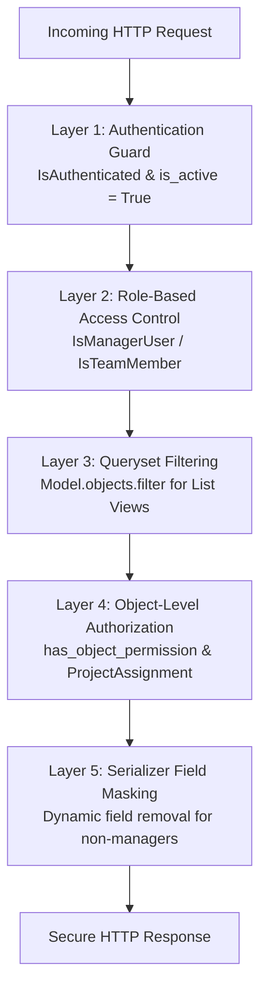

# MarginWatch — Security Architecture & Permissions Specification

**Document Status:** Security Blueprint (Phase 0)  
**Last Updated:** October 2026  
**Audience:** Security Engineers, Backend Architects, Full-Stack Developers  
**Architecture Authority:** [ADR-001: Initial Architecture](decisions/ADR-001-initial-architecture.md) | [ADR-002: Single-Agency Architecture](decisions/ADR-002-single-agency-architecture.md)  
**Financial Rules Authority:** [docs/financial-rules.md](financial-rules.md) | [ADR-003: Financial Rules](decisions/ADR-003-financial-rules-and-risk-classification.md)

---

## 1. Security Philosophy & Fundamental Laws

> [!CAUTION]
> **Core Architectural Security Law:**  
> The client-side application (Next.js frontend) must **NEVER** be treated as the authority for user identity, role assignment, project permissions, business validation, or financial calculations.  
> Hiding or disabling UI controls is a usability feature, **not an authorization mechanism**. Every security boundary, authorization check, and mathematical computation must be enforced server-side on every single request.

### Single-Agency Scope & Boundary
MarginWatch monitors delivery profitability for **one software agency only**:
- **No Multi-Tenant Boilerplate:** The application is deployed per agency. There are no tenant-switching flows, agency ID parameters, or multi-tenant lookup tables.
- **Global Manager Authority:** Users with `role == 'MANAGER'` have global visibility across all application records (clients, projects, time entries, expenses, and financial summaries) within the single agency.
- **Strictly Scoped Team Member Access:** Users with `role == 'TEAM_MEMBER'` access only projects to which they hold an active `ProjectAssignment`, and permitted work data associated with them.
- **Queryset-Level Filtering:** List endpoints must filter querysets server-side. Object-level permission checks alone (`has_object_permission`) are insufficient for securing list responses.
- **Zero Financial Leakage:** Sensitive financial baselines (contract revenue, cost budget, profit margins, internal employee cost rates) must never leak to non-managers through list serializers, nested responses, or alternative endpoints.

---

## 2. Role & Permission Baseline Matrix

The following authoritative matrix governs access control across MarginWatch:

| Action / Capability | Manager (`MANAGER`) | Assigned Team Member (`TEAM_MEMBER`) | Unassigned Team Member (`TEAM_MEMBER`) | Enforcement Layer |
| :--- | :---: | :---: | :---: | :--- |
| **List clients** | **Yes** | **No** by default | **No** | Queryset filter (`/api/v1/clients/`) |
| **Create / update clients** | **Yes** | **No** | **No** | Permission class (`IsManagerUser`) |
| **Create / update projects** | **Yes** | **No** | **No** | Permission class (`IsManagerUser`) |
| **Assign / revoke team members**| **Yes** | **No** | **No** | Permission class (`IsManagerUser`) |
| **View assigned project work** | **Yes** | **Yes** | **No** | Queryset filter & `IsAssignedOrManager` |
| **Log time** | **Yes**, when permitted | **Yes** | **No** | Validation on `ProjectAssignment` |
| **Submit expenses** | **Yes** | **Yes** | **No** | Validation on `ProjectAssignment` |
| **Approve / reject expenses** | **Yes** | **No** | **No** | Action permission (`IsManagerUser`) |
| **View contract revenue & profitability** | **Yes** | **No** by default | **No** | Serializer field masking & view guard |
| **Trigger AI Risk Analysis** | **Yes** | **No** | **No** | Endpoint permission (`IsManagerUser`) |
| **View own profile (`auth/me/`)**| **Yes** | **Yes** | **Yes** | Authenticated (`request.user`) |
| **View own cost rate (`default_hourly_cost_rate`)** | **Yes** | **No** (Masked) | **No** (Masked) | Serializer dynamic field popping |

---

## 3. Server-Side Access Control Mechanisms

MarginWatch enforces security through four distinct, defense-in-depth server-side layers:



### 3.1 Authentication & Active Status Verification (Layer 1)
- Every protected endpoint requires a signed, unexpired JWT token: `Authorization: Bearer <token>`.
- Inactive accounts (`is_active = False`) are rejected immediately with `401 Unauthorized` during authentication. If a user account is deactivated while holding active tokens, subsequent requests fail.

### 3.2 Role-Based Access Control (Layer 2)
Application roles are strictly controlled:
```python
# Conceptual DRF permission class
class IsManagerUser(permissions.BasePermission):
    """
    Allows access only to authenticated users with the MANAGER role.
    """
    def has_permission(self, request, view):
        return bool(
            request.user
            and request.user.is_authenticated
            and request.user.role == "MANAGER"
        )
```
- Django's `is_staff` and `is_superuser` flags are not used for business authorization; business logic strictly checks `request.user.role == 'MANAGER'`.
- Self-role elevation is prohibited: `role` is marked `read_only=True` on all user-facing serializers. Only dedicated, manager-protected administrative views can update a user's role.

### 3.3 Queryset-Level Filtering (Layer 3)
List views never retrieve all records from the database and rely on post-fetch filtering. Querysets are filtered at the database level:
```python
# Conceptual DRF get_queryset pattern
def get_queryset(self):
    user = self.request.user
    if user.role == "MANAGER":
        return Project.objects.filter(is_archived=False)
    # Team members only see active projects to which they are assigned
    return Project.objects.filter(
        assignments__user=user,
        assignments__is_active=True,
        is_archived=False
    ).distinct()
```

### 3.4 Object-Level Access Control & Insecure Direct Object References (IDOR) Defense (Layer 4)
- **Time Entries:** A `TEAM_MEMBER` can update or delete a time entry if and only if `entry.user_id == request.user.id`. Requests targeting another user's entry return `403 Forbidden` (or `404 Not Found` to prevent entity enumeration).
- **Project Assignments:** Non-manager users cannot log time or submit expenses to a project unless an active `ProjectAssignment` (`(project_id, request.user.id, is_active=True)`) exists.
- **Expenses:** A `TEAM_MEMBER` cannot approve or reject an expense; approval endpoints strictly enforce `IsManagerUser`.

### 3.5 Serializer Field Masking (Layer 5)
Sensitive financial attributes are stripped dynamically based on `request.user`:
1. **Wage Rate Concealment:** A team member can never view other members' `default_hourly_cost_rate` or the `hourly_cost_snapshot` on time entries.
2. **Profit & Revenue Masking:** Project serializations for `TEAM_MEMBER` users omit `contract_revenue`, `planned_cost_budget`, `planned_hourly_cost_rate`, and profit calculations.
3. **AI Context Minimization:** When querying Google Gemini, client contact information (phone, email) and employee personal names are completely stripped. Only project codes, aggregated hours, and anonymized metrics are transmitted.

---

## 4. Secrets Management & Environment Hygiene

```
┌─────────────────────────────────────────────────────────────┐
│                     SOURCE CODE REPO                        │
│  - No .env files                                           │
│  - Only .env.example with safe placeholders                 │
└─────────────────────────────────────────────────────────────┘
                               ▲
                               │
               Never committed │ Local / Deployment Injection
                               │
┌──────────────────────────────┴──────────────────────────────┐
│                    ENVIRONMENT VARIABLES                    │
│                                                             │
│  SERVER-SIDE ONLY (Private):                                │
│    - DJANGO_SECRET_KEY                                      │
│    - DATABASE_URL / DATABASE_URL_UNPOOLED                   │
│    - GEMINI_API_KEY  <-- NEVER EXPOSED TO BROWSER           │
│                                                             │
│  CLIENT-SIDE (Publicly Inlined by Next.js):                 │
│    - NEXT_PUBLIC_API_BASE_URL (URL only)                   │
└─────────────────────────────────────────────────────────────┘
```

1. **Strict Key Encapsulation:** The Google Gemini API key resides exclusively in the Django backend environment. It is never prefixed with `NEXT_PUBLIC_` and never transmitted across the wire to the frontend client.
2. **Secret Rotation Protocol:** If an API key or database credential is leaked, it must be invalidated immediately via the provider console, rotated in deployment environments, and Git history scrubbed using `git-filter-repo`.

---

## 5. Web Defenses & Error Reporting

### 5.1 Cross-Origin Resource Sharing (CORS) & CSRF
- `django-cors-headers` is configured with an explicit whitelist (`CORS_ALLOWED_ORIGINS`). Wildcard origins (`*`) are prohibited in production.
- For session authentication, CSRF tokens are strictly validated on all unsafe HTTP methods (`POST`, `PUT`, `DELETE`, `PATCH`).

### 5.2 Rate Limiting (Throttling)
- Authentication endpoints (`/api/v1/auth/login/`): 5 requests/minute per IP to prevent brute-force attacks.
- AI Advisory endpoints (`/api/v1/projects/{id}/ai-risk-analysis/`): 10 requests/hour per user to control AI operational costs.
- Standard CRUD endpoints: 120 requests/minute per user.

### 5.3 Safe Error Reporting
- Production environments enforce `DJANGO_DEBUG=False`.
- Internal system errors return a structured JSON envelope (`{"error": {"code": "INTERNAL_SERVER_ERROR", "message": "..."}}`) without leaking database schema details, stack traces, or module paths.
